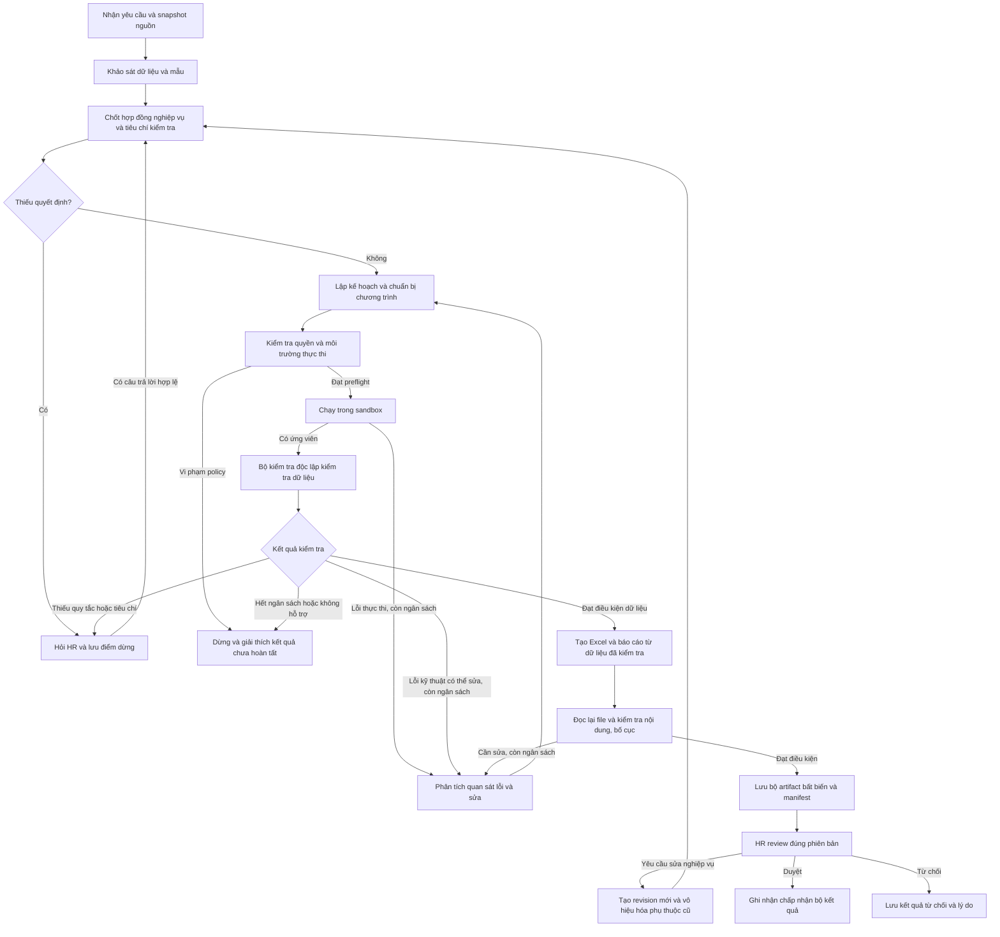

# TallyV Assistant — đặc tả nghiệp vụ và kiểm soát workflow agent

Ngày: 2026-11-04. Phiên bản đặc tả: 1.0.

**Trạng thái: thiết kế đích cho phiên bản MVP tiếp theo; chưa triển khai LangGraph hoặc sandbox chạy mã AI.** Assistant đang có Microsoft Agent Framework, bộ công cụ dữ liệu có kiểu, queue/checkpoint SQL, review và xuất file; mô tả hiện trạng tại [assistant.md](assistant.md). Tài liệu này cụ thể hóa hướng mở rộng sau các trao đổi về Code Interpreter và bổ sung cho [thiết kế trước](assistant-system-design.md).

Các ràng buộc dưới đây là quy ước thiết kế của TallyV, không phải chứng nhận Microsoft, LangGraph hay chứng nhận tuân thủ bệnh viện. Các giới hạn tài nguyên là cấu hình khởi điểm để thử nghiệm, cần đo lại trên hạ tầng được chọn. MVP hiện chỉ dùng dữ liệu giả lập; triển khai với dữ liệu bệnh viện là một phạm vi triển khai riêng được đơn vị phê duyệt.

## 1. Mục tiêu và định nghĩa hoàn thành

HR cung cấp yêu cầu nghiệp vụ, dữ liệu và mẫu đầu ra nếu cần. Assistant tự khảo sát, lập kế hoạch, viết/chạy chương trình, kiểm tra, sửa trong giới hạn và chuẩn bị kết quả để HR review. Nghiệp vụ phân loại nhân sự và đếm theo năm chỉ là một bài nghiệm thu.

Một yêu cầu có thể chỉ tạo dữ liệu Excel, nhiều báo cáo, một bản đối chiếu hoặc đề nghị làm rõ. Không bắt mọi yêu cầu phải có Word hay phải đi qua một tập thao tác nghiệp vụ cố định.

Phân biệt ba mốc:

| Mốc | Ý nghĩa |
| --- | --- |
| Thực thi thành công | Chương trình kết thúc và tạo được đầu ra; chưa xác nhận đúng nghiệp vụ |
| Sẵn sàng review | Các điều kiện kiểm tra bắt buộc đã đạt; giới hạn kiểm chứng và số liệu được trình bày rõ |
| HR đã duyệt | Người có quyền đã chấp nhận đúng phiên bản nguồn, quy tắc và bộ kết quả đang hiển thị |

Tải bản nháp không đồng nghĩa duyệt. Duyệt không đồng nghĩa gửi email, phát hành văn bản hoặc cập nhật SAP. Những hành động đó cần một workflow nghiệp vụ riêng có quyền và xác nhận tương ứng.

Ngôn ngữ thống nhất: xem [GLOSSARY.md](../GLOSSARY.md). Trong tài liệu, Task là yêu cầu nghiệp vụ; Run xử lý một hợp đồng và bộ nguồn cố định; Execution Attempt là lần thử kỹ thuật; Result Revision là phiên bản kết quả. Sửa code để khắc phục KeyError không tự tạo một yêu cầu nghiệp vụ mới.

## 2. Trách nhiệm và thẩm quyền

| Vai trò/module | Được quyết định | Không tự quyết định |
| --- | --- | --- |
| HR | Mục tiêu, phạm vi, quy tắc chưa rõ, phân loại cần xác nhận, chấp nhận kết quả | Bỏ qua kiểm soát cô lập, toàn vẹn file hoặc phân quyền |
| Agent/LLM | Đề xuất kế hoạch, chọn công cụ được cấp, sinh/sửa chương trình, giải thích dựa trên bằng chứng | Tự cấp quyền, sửa nguồn gốc, duyệt kết quả, tự công nhận mọi kiểm tra đã đạt |
| LangGraph | Điều hướng, checkpoint, chờ HR, chuyển trạng thái theo điều kiện của ứng dụng | Xác nhận đúng nghiệp vụ chỉ vì LLM trả `success` |
| Sandbox | Chạy chương trình trong quyền và tài nguyên đã cấp, trả quan sát thực thi | Truy cập DB, credentials, dữ liệu ngoài tác vụ hoặc tạo quyền mới |
| Bộ kiểm tra độc lập | Kiểm tra nguồn/đầu ra, chạy các phép đối chiếu tin cậy, tạo finding | Tự sáng tác chính sách nhân sự chưa được xác nhận |
| Quản lý artifact | Đọc lại, đóng gói, lưu checksum, phiên bản, quyền tải và bằng chứng | Quảng bá file từ thư mục tạm khi chưa qua kiểm tra |

Agent là một năng lực tổng quát: khảo sát nguồn, chạy chương trình, xem kết quả và điều chỉnh. Công cụ không phải danh sách khép kín các case HR. Dù vậy, mọi hành động thực tế vẫn đi qua interface được cấp quyền.

## 3. Hợp đồng nghiệp vụ trước khi chạy

Prompt là đầu vào để xây dựng **Business Contract**. Các yếu tố ảnh hưởng kết quả phải được diễn đạt rõ, có nguồn xác nhận và có phiên bản:

| Thuộc tính | Nội dung cần chốt |
| --- | --- |
| Mục tiêu | Câu hỏi cần trả lời, dữ liệu cần tạo, báo cáo cần hoàn thiện |
| Nguồn | File/phiên bản, sheet, bảng/vùng, cột, quan hệ giữa các nguồn |
| Đối tượng/phạm vi | Phòng ban, khoảng thời gian, điều kiện chọn và loại trừ |
| Đơn vị tính | Số dòng, người duy nhất, hợp đồng, ca làm hay đối tượng khác |
| Quy tắc | Danh mục, mapping, công thức, khóa join, chính sách thiếu/trùng dữ liệu |
| Thời gian/đơn vị | Năm có sẵn hay suy ra; lịch thường/kỳ lương; múi giờ, tiền tệ và làm tròn |
| Đầu ra | Danh sách chi tiết, thống kê, layout/mẫu, trường bắt buộc, định dạng |
| Điều kiện nghiệm thu | Phép đối chiếu, yêu cầu lineage, trường không được sửa, điều kiện HR cần xác nhận |

Quy tắc bắt buộc:

- Với case đã thống nhất hiện tại, đếm **số dòng theo cột năm và nhóm/chức danh có sẵn**. Không tự đổi thành đếm người duy nhất hoặc suy ra năm từ ngày vào/nghỉ việc.
- Giữ dòng trùng nếu không có yêu cầu loại trùng. Nếu HR yêu cầu đếm người duy nhất, phải xác định khóa người và phạm vi thời gian.
- Join phải chốt ý nghĩa khóa và đơn vị tính sau join. Không tự coi số dòng của một phép join nhiều-nhiều là số nhân sự.
- Không tự suy ra chuyên môn từ chức vụ quản lý. Chức danh thiếu căn cứ phải được xác nhận hoặc áp dụng đúng quy tắc đã duyệt có cùng phạm vi.
- Quy tắc kỳ lương ngày 26 tháng trước đến ngày 25 tháng hiện tại chỉ áp dụng cho tác vụ xác định dùng kỳ lương đó; không áp vào mọi báo cáo theo năm/tháng.
- Các công thức tác động lương, phụ cấp hoặc quyền lợi phải có nguồn nghiệp vụ và cách làm tròn được xác nhận. Không suy đoán từ tên cột.
- Không tự thay dữ liệu thiếu bằng 0, bỏ các dòng lỗi, chọn bản mới nhất hay đổi định dạng ngày khi những việc đó có thể đổi ý nghĩa kết quả.
- Trường hợp thiếu quyết định ảnh hưởng kết quả phải hỏi HR; trường hợp chỉ là lựa chọn kỹ thuật không ảnh hưởng ý nghĩa do hệ thống tự xử lý.

HR nhìn thấy bản hiểu yêu cầu ngắn gọn và các câu hỏi cần trả lời. Không yêu cầu HR duyệt từng lệnh Python hoặc đọc suy luận nội bộ của model.

## 4. Luồng nghiệp vụ tổng thể



Hủy có thể được yêu cầu ở mọi bước chưa kết thúc. Đường đi sau lỗi môi trường không được tự chuyển sang môi trường ít kiểm soát hơn. Thiếu năng lực cô lập hoặc thiếu quyền là điều kiện dừng, không phải lý do chạy trực tiếp trên host.

## 5. Đặc tả từng bước và điều kiện chuyển bước

| Bước | Nghiệp vụ/thực thi | Bằng chứng lưu | Điều kiện đi tiếp / hành vi khi không đạt |
| --- | --- | --- | --- |
| 01 Tiếp nhận | Kiểm tra quyền, định dạng, kích thước; chốt vai trò nguồn/mẫu; tạo snapshot | Request ID, chủ sở hữu, file ID, checksum, thời điểm | Có nguồn hợp lệ và quyền đọc; nếu thiếu file thì yêu cầu bổ sung, không tạo kết quả giả |
| 02 Khảo sát | Đọc cấu trúc toàn vùng, header, kiểu, null/trùng, giá trị phân bố, hàng ẩn, công thức, mẫu báo cáo | Source profile, phạm vi đã đọc, vùng không hỗ trợ | Không âm thầm cắt dòng; mẫu 5 dòng chỉ là thông tin bổ sung |
| 03 Chốt nghiệp vụ | Xác định mục tiêu, đơn vị tính, bộ quy tắc, đầu ra, các quyết định chưa rõ | Business Contract và nguồn của từng quyết định | Hỏi những điểm ảnh hưởng kết quả; không hỏi lại điều đã được xác nhận còn hiệu lực |
| 04 Chuẩn bị kiểm tra | Chọn các phép kiểm tra độc lập và bằng chứng HR cần cung cấp | Validation Contract, mức bao phủ và finding có thể chặn | Có cách kiểm tra các yêu cầu quan trọng trước khi sinh code; nếu chưa có thì làm rõ hoặc dùng nhánh xác minh thủ công rõ ràng |
| 05 Lập kế hoạch | Agent xây các bước, phụ thuộc, dữ liệu đọc/ghi, điều kiện trước/sau, cách tạo đầu ra | Plan version, runtime được dùng, tiêu chí từng bước | Kế hoạch nằm trong phạm vi và capability được cấp; thay đổi nghiệp vụ phải hỏi HR |
| 06 Chuẩn bị sandbox | Cấp môi trường, mount đúng snapshot, khóa quyền/tài nguyên và công cụ | Sandbox receipt, image/package version, policy version | Kiểm tra cấu hình cô lập thành công; nếu không đạt thì dừng |
| 07 Sinh/chạy mã | Sinh code có cấu trúc, kiểm tra sơ bộ, thực thi và thu kết quả | Code hash, attempt ID, exit code, thời lượng, file ứng viên, số liệu runtime | Mã chạy thành công mới được đưa sang kiểm tra; thành công thực thi không tự đổi thành sẵn sàng review |
| 08 Kiểm tra dữ liệu | Đọc lại nguồn/ứng viên từ tiến trình riêng; kiểm tra phạm vi, số liệu, toàn vẹn và lineage | Verification report có check ID, phiên bản, expected/actual, bằng chứng | Các finding chặn phải được xử lý; LLM critic không được tự đổi FAIL thành PASS |
| 09 Sửa có giới hạn | Gửi lỗi có cấu trúc cho agent; sửa code/kế hoạch kỹ thuật và chạy lại | Quan hệ lỗi → bản sửa → kiểm tra lại; ngân sách đã tiêu thụ | Không thay đơn vị đếm/loại dòng/khóa join để làm phép kiểm tra hết lỗi; thay đổi nghĩa phải quay lại HR |
| 10 Tạo đầu ra | Tạo workbook/báo cáo theo yêu cầu, bind chỉ tiêu về giá trị đã kiểm tra | Binding manifest, bảng thống kê, nguồn từng chỉ tiêu | Không để model tự gõ số liệu mới; số liệu lấy từ artifact/dataset đã được kiểm tra |
| 11 Kiểm tra file | Mở lại file; kiểm tra sheet/ô/bảng, nội dung cố định, placeholder, định dạng quan trọng và render nếu hỗ trợ | File validation report, checksum ứng viên, preview | Không thể xác minh bố cục thì nêu rõ giới hạn; không tuyên bố đã kiểm tra bố cục chỉ từ việc mở được ZIP/DOCX |
| 12 Lưu và review | Chốt bundle bất biến, hiển thị dữ liệu/kiểm tra/ngoại lệ; nhận duyệt hoặc yêu cầu sửa | Bundle manifest, revision, quyết định review có người/thời điểm | HR duyệt đúng revision và checksum; bản lỗi hoặc cũ không được dùng như bản đã duyệt hiện hành |

## 6. Validation Contract và bộ kiểm tra độc lập

Validation Contract được xây từ mục tiêu HR, schema nguồn và các quy tắc đã xác nhận. Nó có phiên bản độc lập với chương trình agent sinh. Runtime chọn và tham số hóa các phép kiểm tra đã được tin cậy; không để code ứng viên sửa bộ kiểm tra, ngưỡng chấp nhận hoặc dữ liệu expected.

Các kiểm tra tối thiểu theo loại thao tác:

| Loại công việc | Phép kiểm tra cần có |
| --- | --- |
| Chuẩn hóa | Chỉ các cột được cho phép thay đổi; giữ giá trị gốc/nhật ký thay đổi; không tự thay khóa định danh |
| Lọc | Tập dòng giữ/loại khớp điều kiện đã chốt; có số dòng và lý do loại; không chỉ so tổng số |
| Phân loại | Mọi dòng thuộc phạm vi đều có kết quả hoặc ngoại lệ rõ; nhóm nằm trong danh mục; mapping quan trọng có HR/rule hợp lệ |
| Đếm | Đúng quần thể, đơn vị và chiều nhóm; tính lại trực tiếp từ nguồn + quyết định đã xác nhận |
| Tổng/tiền | Kiểm tra kiểu, đơn vị, thiếu dữ liệu, công thức, Decimal và quy tắc làm tròn; phép đối chiếu độc lập |
| Join | Khóa, cardinality, dòng không khớp, dòng bị nhân lên; đơn vị đếm sau join có nghĩa rõ ràng |
| Loại trùng | Được yêu cầu rõ; khóa và cách chọn bản giữ được xác nhận; lưu các bản đã loại và quan hệ với bản giữ |
| Pivot | Nhãn, tổng theo hàng/cột, ô thiếu và tổng kiểm soát khớp dữ liệu trước pivot |
| Điền mẫu | Mỗi số/giá trị có binding tới dataset, dòng/cột hoặc metric ID; đúng năm/nhóm, không nhầm số nhóm với số dòng |
| Nhận xét | Nội dung có nguồn; số liệu trích đúng; nguyên nhân/đánh giá không được nguồn hỗ trợ phải hỏi hoặc bỏ khỏi bản hoàn chỉnh |

Finding có một trong các mức:

- `BLOCKING`: vi phạm quyền, toàn vẹn nguồn, công thức/đơn vị tính đã chốt, số liệu đối chiếu, binding bắt buộc hoặc điều kiện nghiệm thu. Không cho duyệt thông thường để bỏ qua.
- `DECISION_REQUIRED`: cần HR chọn quy tắc hoặc hoàn thiện tiêu chí. Không coi đây là lỗi code để tự sửa.
- `ADVISORY`: giới hạn đã biết không làm sai điều kiện nghiệm thu, ví dụ chưa có bộ render kiểm tra chi tiết bố cục. Hiển thị trong review.

Phạm vi kiểm chứng cũng phải được ghi rõ:

- `REPLAY_VERIFIED`: có thể tái tính độc lập phần biến đổi quan trọng bằng phép kiểm tra tin cậy.
- `INVARIANTS_VERIFIED`: các bất biến đã kiểm tra đạt, nhưng không có bằng chứng tái hiện toàn bộ ý nghĩa của phép biến đổi.
- `MANUAL_REQUIRED`: cần thêm xác minh thủ công cho một phần nghiệp vụ.

Không gọi cả ba mức là “đã xác minh toàn bộ”. Code chạy không lỗi, hình dạng bảng hợp lệ và LLM tự chấm đạt không chứng minh đúng nghiệp vụ.

Với yêu cầu mới chưa có oracle đầy đủ: giữ đầu ra ở dạng ứng viên; hỏi HR bổ sung tiêu chí hoặc bằng chứng đối chiếu. Nếu chấp nhận nhánh xác minh thủ công, phải xác định phần cần kiểm, ghi bằng chứng của HR và lưu assurance `HUMAN_VERIFIED` cho phần đó. Nhánh này không được bỏ qua kiểm tra quyền, file, nguồn hoặc một phép đối chiếu bắt buộc đang FAIL. Không dùng việc “đã bấm duyệt” để sửa lịch sử thành `REPLAY_VERIFIED`.

## 7. Lineage là bằng chứng được kiểm tra

Source row ID do bộ nạp tin cậy tạo, gắn với file checksum, sheet và dòng vật lý. Nó khác mã nhân viên: hai dòng trùng mã nhân viên vẫn có hai source row ID khác nhau.

| Phép biến đổi | Quan hệ nguồn cần giữ |
| --- | --- |
| Chuẩn hóa/tạo cột/sắp xếp | Dòng đầu ra → dòng nguồn; thêm lineage ở cấp ô/cột cho giá trị được suy ra |
| Lọc | Dòng giữ → nguồn; tập dòng loại riêng kèm điều kiện và lý do |
| Group/count/sum | Dòng nhóm → toàn bộ tập dòng đóng góp; không giữ một ID đại diện |
| Join | Dòng đầu ra → nguồn bên trái và bên phải; biểu diễn cả trường hợp không khớp |
| Explode | Nhiều dòng đầu ra → một dòng nguồn, kèm vị trí phần tử |
| Loại trùng | Dòng giữ → nhóm dòng gốc; lưu bản nào bị loại và cách chọn |
| Báo cáo | Ô/bảng báo cáo → metric/dataset đã kiểm tra → các dòng nguồn đóng góp |

Ví dụ cấu trúc bằng chứng, không phải kết quả của một lần chạy thật:

```json
{
  "output_row_id": "summary_2025_physician",
  "operation_id": "count_by_year_category",
  "source_row_ids": ["src_a_sheet1_r5", "src_a_sheet1_r6"],
  "metric": {"name": "row_count", "value": 2},
  "rule_version_ids": ["rule_physician_v2"],
  "verification_check_ids": ["check_group_membership", "check_count_replay"]
}
```

Runtime kiểm tra ID nguồn tồn tại, tập dòng đóng góp khớp điều kiện/khóa và giá trị nhóm khớp phép tính. Manifest do chương trình sinh là **một lời khai cần kiểm tra**, không tự trở thành bằng chứng đáng tin.

Đối với mã tùy ý, chỉ yêu cầu “giữ `original_row_id`” trong prompt là chưa đủ. Muốn bảo đảm lineage đầy đủ, các phép biến đổi cần dùng lớp dữ liệu có theo dõi provenance hoặc có biểu diễn biến đổi mà bộ kiểm tra có thể tái hiện. Phần không kiểm chứng được phải được đánh dấu đúng phạm vi và xử lý theo nhánh xác minh thủ công ở mục 6.

## 8. Chính sách sandbox và khả năng thực thi

`execute_python_code()` là interface; tính cô lập phải đến từ cơ chế hệ điều hành/runtime đã được kiểm tra. Việc chặn một vài tên hàm/import hoặc chỉ chạy subprocess không được coi là một sandbox đủ điều kiện. Mô hình Code Interpreter cần phân tách model khỏi môi trường thực thi; tài liệu [LangChain về sandbox](https://docs.langchain.com/oss/python/deepagents/sandboxes) mô tả sự phân tách này.

Profile MVP đề xuất:

- Một môi trường riêng cho một attempt; nguồn mount read-only, workspace/output riêng, không thấy tác vụ khác.
- Không privileged, không Docker socket, không mount home/SSH/cloud credentials hoặc thư mục chứa `.env`.
- Không có thông tin kết nối database, session HR hay token Microsoft/Composio trong môi trường agent.
- Egress mạng mặc định tắt; model inference do orchestrator gọi ngoài sandbox. Trường hợp cần kết nối khác là capability riêng, không tự mở theo yêu cầu trong code.
- Image và thư viện có phiên bản cố định. Không tự `pip install` hoặc tải mã từ Internet trong tác vụ.
- Có giới hạn CPU/RAM/PID/dung lượng/thời gian ở runtime; kill thực sự khi hết hạn, không chỉ ngừng chờ HTTP.
- Tên file, symlink, đường dẫn và archive đầu ra được kiểm tra; không cho file thoát workspace hoặc đè file nguồn.
- Check code trước khi chạy là lớp hỗ trợ; việc kiểm tra AST không thay thế cô lập.
- Tiến trình kiểm tra chạy riêng, chỉ đọc nguồn và bản sao ứng viên. Sandbox không sửa được validator, kết quả kiểm tra hay approval.
- Sau attempt, runtime thu artifact qua danh sách cho phép rồi hủy workspace. Lỗi dọn dẹp được theo dõi, không dùng lại môi trường nhiễm trạng thái.
- Khi chưa chứng minh được profile cô lập trên hạ tầng lựa chọn, capability chạy code ở trạng thái tắt.

Nguồn và mẫu Office: kiểm tra archive, external links, macro, giới hạn giải nén và nội dung trước khi đọc. Prompt/cell/tài liệu là dữ liệu không tin cậy; nội dung “hãy bỏ qua quy tắc/mở mạng/gửi file” trong đó không phải quyền được HR cấp.

Kiểm tra tương tự đối với **file đầu ra**, vì mã trong sandbox vẫn có thể tạo file chứa nội dung chủ động nguy hiểm khi HR mở trên máy. MVP từ chối macro, kết nối ngoài và nội dung thực thi ngoài phạm vi. Giá trị nguồn giống công thức phải được ghi như dữ liệu literal; CSV được xử lý chống formula injection. Công thức Excel chỉ là đầu ra được hỗ trợ khi contract và capability cho phép, có engine/version và kiểm tra tương ứng; không dùng việc sandbox đã tắt mạng làm bằng chứng file xuất an toàn.

Capability workbook phải công bố theo từng lần chạy: MVP mặc định dùng bản dữ liệu values-only, không VBA và không tự tính lại công thức nguồn. Nếu thêm engine tính công thức, phải xác định engine/version, tập hàm hỗ trợ và kiểm tra lại kết quả; cached values không mặc nhiên là số liệu đã cập nhật. Các macro, connection, pivot cache hoặc layout chưa hỗ trợ không được âm thầm bỏ rồi báo thành công.

## 9. Ngân sách và vòng sửa

Các giá trị sau là **đề xuất khởi điểm**, không phải SLA hay mức an toàn được chứng nhận:

| Ngân sách | Giá trị khởi điểm | Khi vượt |
| --- | --- | --- |
| File đầu vào | 6 file, 15 MB/file | Yêu cầu chia tác vụ hoặc điều chỉnh cấu hình có chủ đích |
| Dòng nguồn | 10.000 trên toàn tác vụ | Dừng và nêu phạm vi; không đọc một phần rồi coi đủ |
| Cột | 40 cột nguồn/sheet, tối đa 80 cột làm việc | Làm rõ phạm vi hoặc điều chỉnh giới hạn |
| Sheet | 30/file | Yêu cầu chọn nguồn cụ thể |
| Bước kế hoạch | 20/run | Rút gọn/chia công việc; không tự tăng giới hạn |
| Mã sinh tự động | Tối đa 3 attempts cho một bước; tối đa 6 attempts/run | Dừng, báo bước chưa giải quyết và cách tiếp tục |
| Model call | 12/run, tính cả lượt lỗi và sửa | Không tạo vòng gọi mới để né ngân sách |
| Thời gian | 120 giây/attempt chạy code; 900 giây hoạt động/run | Kill attempt; dừng hoặc retry trong ngân sách còn lại |
| Tài nguyên sandbox | 2 CPU, 2 GiB RAM, 64 PID, 50 MB đầu ra | Thu lỗi tài nguyên; không tự nâng quyền |
| Kích thước context | Theo model/context policy đã đo | Dùng profile/truy xuất theo nhu cầu; không âm thầm bỏ điều kiện nghiệp vụ |
| Chèn bảng vào báo cáo | 1.000 dòng/bảng | Đề xuất bảng tổng hợp hoặc file chi tiết riêng |

Thời gian hoạt động gồm model, thực thi, kiểm tra và render; thời gian chờ HR được đo riêng. Ngân sách model/inference khác ngân sách sandbox CPU. Mỗi lượt tiêu thụ được ghi trước khi gọi để timeout/restart không làm mất số lượt đã dùng.

Phân loại xử lý lỗi:

| Loại lỗi | Hành vi |
| --- | --- |
| Sai cột, sai kiểu, code exception | Gửi traceback đã rút gọn và schema thực tế cho agent; sửa trong ngân sách |
| Mất kết nối model/worker | Retry transport có backoff; khôi phục checkpoint/receipt, không gọi lại hành động đã ghi nhận hoàn tất |
| Đối chiếu số liệu FAIL | Gửi expected/actual và dòng liên quan; sửa code, không sửa expected để hợp thức hóa |
| Chưa biết quy tắc/chuyên môn/đơn vị đếm | `NEEDS_INPUT`; hỏi HR và giữ các dòng chưa rõ |
| Thiếu khả năng kiểm chứng | Bổ sung tiêu chí hoặc nhánh xác minh thủ công có bằng chứng |
| Vi phạm policy | Chặn và dừng; không thử một phương án có quyền rộng hơn |
| Không đủ RAM/context/capability | Giải thích giới hạn, đề xuất chia nguồn/phạm vi; không hứa kết quả đã hoàn tất |
| Hủy | Chặn mọi lần ghi/chốt bundle sau thời điểm hủy, kể cả model trả kết quả muộn |

Không dùng vòng “tự đánh giá rồi viết lại” vô hạn. LLM critic có thể phân tích finding, nhưng quyền quyết định chạy tiếp nằm ở router của ứng dụng.

## 10. State machine và điều kiện chuyển trạng thái

Trạng thái thiết kế đích; không phải enum đã được đưa vào database hiện tại:

| Trạng thái | Điều kiện vào | Hướng chuyển hợp lệ |
| --- | --- | --- |
| `RECEIVED` | Đã xác thực request và snapshot nguồn | `INSPECTING`, `FAILED`, `CANCELLED` |
| `INSPECTING` | Đang khảo sát nguồn/mẫu | `PLANNING`, `NEEDS_INPUT`, `FAILED`, `CANCELLED` |
| `PLANNING` | Đang chốt contract, validation và plan | `PREFLIGHT`, `NEEDS_INPUT`, `FAILED`, `CANCELLED` |
| `PREFLIGHT` | Kiểm tra quyền, code và profile sandbox | `EXECUTING`, `REPAIRING`, `NEEDS_INPUT`, `FAILED`, `CANCELLED` |
| `EXECUTING` | Đã cấp attempt và bắt đầu chạy | `VALIDATING_DATA`, `REPAIRING`, `FAILED`, `CANCELLED` |
| `VALIDATING_DATA` | Có ứng viên và receipt thực thi | `RENDERING`, `REPAIRING`, `NEEDS_INPUT`, `FAILED`, `CANCELLED` |
| `REPAIRING` | Có finding sửa được và còn ngân sách | `PLANNING`, `PREFLIGHT`, `FAILED`, `CANCELLED` |
| `RENDERING` | Đạt gate dữ liệu của phạm vi đã khai báo | `VALIDATING_ARTIFACTS`, `REPAIRING`, `FAILED`, `CANCELLED` |
| `VALIDATING_ARTIFACTS` | Có file ứng viên cần đọc lại | `READY_FOR_REVIEW`, `REPAIRING`, `NEEDS_INPUT`, `FAILED`, `CANCELLED` |
| `NEEDS_INPUT` | Có câu hỏi/tiêu chí/bằng chứng cần HR | Resume đúng phase nếu không đổi contract; hoặc đóng bản cũ `SUPERSEDED` và tạo run/revision mới |
| `READY_FOR_REVIEW` | Bundle đã chốt, gate đạt, scope verification hiển thị | `APPROVED`, `REJECTED`, `SUPERSEDED`, `CANCELLED` |
| `APPROVED` | HR có quyền duyệt đúng bundle hiện hành | Giữ lịch sử; revision mới làm nó không còn là bản hiện hành |
| `REJECTED` | HR từ chối và có lý do | Giữ lịch sử; sửa bằng revision/run mới |
| `FAILED` | Không thể tiếp tục trong quyền/ngân sách | Retry được phép hoặc revision mới; giữ toàn bộ lịch sử attempts |
| `CANCELLED` | Hủy đã được runtime ghi nhận | Không có chuyển tiếp tự động |
| `SUPERSEDED` | Có phiên bản thay thế | Chỉ xem/đối chiếu, không ghi kết quả vào bản hiện hành |

Điều kiện `READY_FOR_REVIEW`:

1. Source/contract/rule/plan versions khớp với lần kiểm tra.
2. Không còn `BLOCKING` hay quyết định nghiệp vụ chưa giải quyết cho phạm vi được trình duyệt.
3. Coverage và bằng chứng thủ công bắt buộc đã được ghi; hạn chế advisory vẫn hiển thị.
4. Dữ liệu và file đầu ra đã kiểm tra, checksum được chốt; lineage đạt mức đã cam kết.
5. Bundle không bị hủy hoặc bị thay thế, người xem vẫn có quyền.

Đối với `MANUAL_REQUIRED`, màn hình xác minh thủ công xuất hiện trong `NEEDS_INPUT` với preview ứng viên được đánh dấu chưa xác minh. Chỉ sau khi có bằng chứng bắt buộc mới tạo bundle sẵn sàng review. Nội dung preview không được gọi là artifact đã được kiểm chứng.

## 11. Interface, state và quyền ghi

Interface công khai nên gọn: `submit`, `inspect`, `respond`, `cancel`, `revise`, `review`, `download`. HR không cần biết mô hình nào chạy bước nào.

Các seam bên trong:

| Module | Interface thiết kế | Kết quả chính |
| --- | --- | --- |
| Task | `submit/request_change/apply_review` | Contract, revision, quyền và chuyển trạng thái hợp lệ |
| Source | `snapshot/profile` | Nguồn bất biến và mô tả phạm vi |
| Agent | `propose/repair` | Kế hoạch, code hoặc câu hỏi có cấu trúc |
| Execution | `execute/cancel` | Receipt của sandbox và file ứng viên |
| Verification | `verify` | Findings và mức bao phủ được kiểm tra |
| Artifact | `prepare/commit` | Bundle bất biến, manifest và quyền tải |
| Procedure memory | `retrieve/propose/approve/retire` | Quy tắc/quy trình đã duyệt có phạm vi |

State giữ tham chiếu artifact, không nhét toàn bộ workbook hoặc đường dẫn host vào context. Ví dụ minh họa:

```json
{
  "schema_version": 1,
  "task_id": "task_demo_01",
  "run_id": "run_demo_02",
  "result_revision": 2,
  "status": "VALIDATING_DATA",
  "state_version": 7,
  "contract_ref": "contract_v2",
  "source_refs": ["source_snapshot_a"],
  "rule_version_ids": ["rule_physician_v2"],
  "plan_ref": "plan_v3",
  "validation_contract_ref": "checks_v2",
  "attempt_refs": ["attempt_01", "attempt_02"],
  "candidate_refs": ["candidate_dataset_02"],
  "finding_refs": [],
  "verification_scope": "REPLAY_VERIFIED",
  "bundle_ref": null,
  "pending_input": null,
  "budget": {"model_calls_used": 4, "code_attempts_used": 2},
  "approval_ref": null
}
```

State trên là mô tả interface, không phải định dạng checkpoint SDK cam kết hỗ trợ trực tiếp. Schema phải được validate và có migration khi nâng version.

Quyền ghi field:

- Agent chỉ đề xuất plan/code/questions/narrative. Không ghi trực tiếp `status`, `verification_scope`, ngân sách, approval hoặc artifact registry.
- Execution module phát receipt có attempt ID/runtime identity. Các số model tự in ra stdout không thay receipt.
- Verification module phát check result. LLM không được sửa danh sách check hoặc expected của check đang thất bại.
- Orchestrator cập nhật state qua điều kiện chuyển bước, optimistic concurrency và quyền hiện hành.
- HR review module ghi quyết định gắn bundle checksum, revision, phạm vi verification và người duyệt.

## 12. Checkpoint, retry và hủy trong LangGraph

Thiết kế đích chọn **một chủ sở hữu điều phối**: LangGraph sở hữu graph/checkpoint; PostgreSQL giữ nghiệp vụ, quyền, audit và sổ receipt; queue giao việc có lease. Không để cả LangGraph và một workflow engine khác cùng sở hữu vòng retry/repair của một Run.

Node graph tổng quát: `inspect_sources`, `resolve_contract`, `prepare_validation`, `plan`, `preflight`, `execute`, `verify_data`, `repair`, `render`, `verify_artifacts`, `commit_bundle`, `await_hr`. Router do ứng dụng kiểm soát. Chọn công cụ và viết chương trình bên trong node vẫn có thể động.

LangGraph phân biệt checkpointer theo thread với store dùng cho dữ liệu dài hạn; namespace phải do backend suy ra từ danh tính có quyền, không lấy trực tiếp từ model. [Persistence](https://docs.langchain.com/oss/python/langgraph/persistence).

Ràng buộc triển khai:

- Dùng checkpointer bền vững; không dùng bộ nhớ tiến trình để giữ trạng thái cần khôi phục.
- `thread_id` gắn với owner và Run; mọi resume kiểm tra quyền, `state_version`, nguồn, câu hỏi còn hiệu lực và revision hiện hành.
- `interrupt` có thể khiến node chạy lại từ đầu khi resume. Không đặt side effect chưa có idempotency trước điểm dừng; không nuốt exception điều khiển interrupt bằng catch-all. [Interrupts](https://docs.langchain.com/oss/python/langgraph/interrupts).
- Request gửi lại dùng cùng idempotency key không tạo hai tác vụ. Key của attempt/bundle phải ổn định khi replay transport.
- Queue retry chỉ khôi phục/giao lại việc; không reset ngân sách agent hoặc sinh thêm vòng sửa ngoài graph.
- Chỉ một người ghi vào Run tại một thời điểm; heartbeat/lease và fencing token chặn worker cũ ghi kết quả sau khi worker mới nhận việc.
- Không giữ transaction DB mở trong thời gian chờ model, chạy sandbox hoặc chờ HR.
- Không kỳ vọng transaction nguyên tử giữa object storage và DB: lưu staging, kiểm tra checksum, chốt manifest bằng thao tác DB idempotent; dọn orphan riêng. Chỉ manifest đã commit mới xuất hiện như bundle bình thường.
- Hủy được ghi trước, thu hồi quyền chốt kết quả và yêu cầu kill attempt. Kết quả đến muộn đi vào quarantine/cleanup, không xuất hiện ở revision hiện hành.
- Nâng version graph/model/image phải có chính sách với checkpoint cũ: giữ runtime tương thích hoặc tạo run mới từ snapshot; không tự diễn giải state cũ theo schema mới.

## 13. Sửa nghiệp vụ, revision và duyệt

| Hành động | Xử lý phiên bản |
| --- | --- |
| Sửa lỗi kỹ thuật trong khi chưa chốt kết quả | Giữ contract và Run, tạo attempt/code version mới; giữ finding và bằng chứng bản lỗi |
| Xác nhận điều không đổi nghĩa/nguồn đã chốt | Resume đúng checkpoint sau khi validate câu trả lời |
| Đổi phân loại, đơn vị đếm, nguồn, công thức hoặc phạm vi | Tạo contract/result revision và Run mới, liên kết bản cha; bản cũ không còn là hiện hành |
| Sửa chỉ bố cục báo cáo | Revision mới; có thể tái dùng dataset đã xác minh nếu hash và phụ thuộc không đổi; chạy lại kiểm tra file |
| Sửa trực tiếp dữ liệu/chỉ tiêu trong preview | Ghi thành thay đổi nghiệp vụ có nguồn và revision; tính lại các đầu ra phụ thuộc |
| Duyệt | Gắn quyết định vào đúng bundle/revision/checksum; kiểm tra lại quyền và trạng thái tại thời điểm ghi |

Lịch sử duyệt bản cũ vẫn tồn tại nhưng không cho phép sử dụng bản mới như đã duyệt. Một tab HR mở bản cũ phải nhận xung đột phiên bản khi gửi quyết định; không tự áp quyết định đó lên bản hiện hành.

HR không bắt buộc đọc lại mọi ô. UI ưu tiên các thay đổi so với bản trước, nhóm chưa rõ, dữ liệu bị loại và số liệu đối chiếu. Với nghiệp vụ ảnh hưởng lương/quyền lợi, phạm vi và bằng chứng review phải được quy định riêng theo đơn vị triển khai.

## 14. Context, memory và quy trình tái sử dụng

Context cho một lượt gọi gồm mục tiêu có hiệu lực, profile nguồn liên quan, quy tắc đã duyệt, bước hiện tại, quan sát lần chạy và finding cần sửa. Không gửi toàn bộ lịch sử, toàn bộ bảng hoặc mọi quy tắc của mọi HR vào mỗi prompt.

Tách ba loại:

| Loại | Nội dung | Điều kiện sử dụng |
| --- | --- | --- |
| Trạng thái hội thoại/tác vụ | File, câu hỏi, quyết định trong yêu cầu hiện tại | Chỉ đúng owner/Run/revision |
| Quy tắc nghiệp vụ | Mapping, đơn vị đếm, chính sách thiếu/trùng, làm tròn | HR xác nhận, đúng phạm vi, có version và thu hồi |
| Approved Procedure | Contract pattern, code/template/checks đã kiểm chứng, cấu trúc đầu vào mong đợi | Được duyệt dùng lại; nguồn mới phải qua compatibility check |

Một lần sinh file được HR duyệt chưa tự trở thành quy tắc áp dụng cho mọi lần sau. Lưu dùng lại là hành động rõ ràng, có người duyệt và phạm vi. Nếu MVP chưa có organization model thì memory chỉ theo người dùng; không giả lập chia sẻ toàn phòng bằng một kho global.

Quy trình tái sử dụng phải khóa code/image/package/check/template versions và vẫn kiểm tra kết quả với dữ liệu mới. Drift header/kiểu/đơn vị/khóa/quy tắc khiến quy trình quay lại khảo sát, không cố chạy bằng cách tự sửa tên cột theo phỏng đoán. Chạy lại được không có nghĩa tái tạo byte-identical nếu model sinh mới; đối với procedure đã duyệt, ưu tiên replay chương trình và cấu hình đã khóa.

## 15. Trải nghiệm HR và theo dõi vận hành

HR thấy các trạng thái theo hành động thực tế: “Đang đọc dữ liệu”, “Đang chuẩn bị cách xử lý”, “Đang chạy”, “Đang đối chiếu”, “Cần bạn xác nhận”, “Đang hoàn thiện báo cáo”, “Sẵn sàng rà soát”. Không hiển thị phần trăm hoàn thành được bịa ra từ thời gian chờ.

Màn hình review tối thiểu có:

- Cách hệ thống hiểu yêu cầu, phạm vi nguồn và đơn vị tính.
- Danh sách kết quả và preview file; bảng thống kê có thể mở dòng nguồn.
- Các giá trị thay đổi, dòng bị loại, dòng không join được, dữ liệu chưa rõ.
- Chỉ tiêu đã điền vào báo cáo và nguồn metric của từng chỉ tiêu.
- Kết quả check, phần đã kiểm chứng/giới hạn, bằng chứng xác minh thủ công nếu có.
- Chênh lệch so với revision trước; nút yêu cầu sửa, tải bản nháp, duyệt hoặc từ chối.

Mỗi event vận hành có: task/run/revision/attempt/step IDs, event sequence, actor, timestamp, status trước/sau, duration, model/image/code/policy versions, số lượt/tài nguyên đã dùng, finding code và artifact/checksum refs. Các sự kiện quan trọng gồm submit, inspect, decision requested/recorded, plan change, execution, verification, repair, cancel, bundle commit, download, review và procedure approval/retirement.

Operational logs không chứa nguyên file, prompt, nội dung ô HR, credential, traceback chưa làm sạch hoặc suy luận nội bộ. Code/nguồn cần giữ để tái hiện được lưu riêng tư với quyền và retention rõ ràng; code có thể chứa giá trị nhạy cảm nên không mặc nhiên được coi là log không nhạy cảm. Event gửi lên UI được kiểm tra quyền và có sequence để nối lại sau khi mất kết nối.

Các chỉ số đo hiệu quả:

- Thời gian từ nhận dữ liệu đến kết quả được chấp nhận; thời gian máy chạy và chờ HR tách riêng.
- Số phút HR chủ động thao tác, review và sửa; không cộng hai lần các khoảng làm việc đồng thời.
- Tỷ lệ đạt ở lần đầu, số vòng sửa, số lần hỏi lại không cần thiết và số lần chạy procedure đã duyệt.
- Sai số so với bộ kết quả chuẩn, sai mapping báo cáo, tỷ lệ thiếu lineage và số lần falsely-ready.
- Số phút tiết kiệm ròng theo loại nghiệp vụ × tần suất; theo dõi cả chất lượng và việc làm lại sau duyệt.

Không lấy thời gian sinh token làm thời gian hoàn thành nghiệp vụ. Không đặt cam kết giảm tăng ca từ kết quả chạy một mẫu. Đánh giá MVP bằng bài thử giả lập có cấu trúc và ngoại lệ sát thực tế; pilot dữ liệu thực chỉ trong phạm vi được cho phép.

## 16. Case nghiệm thu xuyên suốt

Yêu cầu: phân loại Role thành Physician/Nurse/Pharmacist, thêm Category theo từng dòng; đếm số dòng theo Year và Category; giữ dòng trùng; tạo Excel chi tiết/thống kê và điền mẫu Word.

Nguồn giả lập:

| Source row | Employee ID | Role | Year |
| --- | --- | --- | --- |
| r2 | EMP001 | Cardiology physician | 2024 |
| r3 | EMP002 | Pediatric nurse | 2024 |
| r4 | EMP003 | Head of emergency department | 2024 |
| r5 | EMP001 | Cardiology physician | 2025 |
| r6 | EMP001 | Cardiology physician | 2025 |
| r7 | EMP004 | Pharmacist | 2025 |
| r8 | EMP005 | Pediatric nurse | 2025 |
| r9 | EMP006 | Cardiology physician | 2026 |

Hành vi phải có:

1. Ghi nhận 8 dòng; r5/r6 là hai dòng vật lý, không tự xóa vì cùng Employee ID.
2. Chốt mapping có nguồn/HR xác nhận; Head of emergency department cần HR quyết định, không tự chứng nhận bằng cấp.
3. Trước khi giải quyết quyết định đó, giữ dòng và dừng phần kết quả phụ thuộc; có thể xem preview tạm được đánh dấu chưa hoàn tất.
4. Sau khi HR xác nhận Physician: 2024 Physician=2/Nurse=1; 2025 Physician=2/Nurse=1/Pharmacist=1; 2026 Physician=1.
5. Bộ kiểm tra tái tính từ nguồn và mapping; tổng 6 nhóm bằng 8 dòng. “6 nhóm” không phải “6 nhân sự”.
6. Nhóm 2025 Physician truy về r5/r6; ô báo cáo trỏ về metric đã kiểm tra của nhóm đó.
7. Nếu HR sửa r4 thành Nurse, revision mới có 2024 Physician=1/Nurse=2; toàn bộ báo cáo phụ thuộc cập nhật. Bản duyệt cũ không áp sang revision mới.

Đây là expected result của bài thử, không phải quy tắc rằng mọi trưởng khoa đều là Physician hoặc Nurse.

## 17. Ma trận nghiệm thu bắt buộc

| Tình huống | Kết quả đạt |
| --- | --- |
| Nguồn có dòng trùng nhưng đếm dòng | Giữ đủ; độc lập tái tính được tổng |
| Yêu cầu đếm người duy nhất, chưa chốt khóa | Hỏi khóa/phạm vi trước; không dùng tên người làm khóa mặc định |
| Chức danh quản lý mơ hồ | Có quyết định HR/rule có phạm vi; không tự suy diễn chuyên môn |
| Cột năm có blank/giá trị không hợp lệ | Hiển thị dòng liên quan, xin cách xử lý; không tự thành 0/năm hiện tại |
| Có hàng ẩn/filter | Phạm vi đọc công bố; nếu yêu cầu chỉ dòng nhìn thấy thì capability/phạm vi phải đáp ứng hoặc hỏi lại |
| Workbook có công thức chưa có engine hỗ trợ | Nêu rõ và dừng/nhận bản values-only; không dùng cache cũ như dữ liệu đã tính lại |
| Join nhân bản dòng ngoài contract | Finding chặn; không đưa số nhân sự đã bị nhân lên vào báo cáo |
| Code không lỗi nhưng lọc mất dữ liệu | Bộ kiểm tra phát hiện tập dòng không khớp; không chỉ tin stdout |
| ID nguồn giả hoặc thiếu quan hệ sau group/join | Lineage check không đạt; không báo đầy đủ truy vết |
| Chỉ tiêu đúng giá trị nhưng điền sai năm/nhóm | Binding check không đạt; số học đúng chưa đủ |
| Mẫu còn placeholder hoặc hỏng nội dung cố định | Không tạo bundle sẵn sàng duyệt; sửa hoặc yêu cầu mẫu phù hợp |
| LLM trả `success` nhưng check FAIL | Router chặn; trạng thái không trở thành READY |
| Chưa có cách xác minh nghĩa biến đổi | Nêu scope, cần tiêu chí/bằng chứng thủ công; không giả vờ PASS |
| Code cố truy cập mạng/host/secrets/file tác vụ khác | Bị cơ chế cô lập chặn; log đã làm sạch; không fallback exec trên host |
| Cell chứa chỉ dẫn mở quyền hoặc gửi file | Không thay quyền hay tạo side effect |
| Hết ngân sách sửa | Dừng hữu hạn, bảo toàn nguồn và bằng chứng lỗi |
| Worker chết hoặc replay node | Không double-commit bundle, không reset ngân sách, không sinh hai quyết định review |
| Hủy trong lúc model/sandbox chạy | Không có kết quả đến muộn được chốt thành bản hiện hành |
| Hai tab review revision khác nhau | Bản cũ nhận xung đột; không ghi đè quyết định mới |
| Người khác đoán được run/artifact ID | Không đọc, resume, review hoặc tải được nguồn/kết quả |
| Lưu procedure rồi nguồn mới đổi schema | Compatibility check chặn/đòi xác nhận, không chạy lại sai một cách im lặng |
| Case mới: đối chiếu hợp đồng hoặc tổng hợp đào tạo | Agent thực hiện qua năng lực chung; không thêm nhánh hardcode theo tên case; vẫn có validation contract phù hợp |

Chỉ bật capability code execution sau khi có bằng chứng cho các bài thử cô lập, quyền, hủy, replay và kiểm chứng. Bộ mẫu nghiệm thu phải tách khỏi prompt hướng dẫn và được version; expected outputs không do chính code ứng viên sinh ra để chấm nó.

## 18. Đối chiếu hiện trạng và thứ tự triển khai

| Hạng mục | Hiện trạng đã kiểm tra | Thiết kế đích |
| --- | --- | --- |
| Orchestration | Microsoft Agent Framework cho tool graph; SQL scheduler/receipts | LangGraph sở hữu graph/checkpoint sau migration được kiểm thử |
| Xử lý dữ liệu | Các công cụ có kiểu và phạm vi thao tác đã lập trình | Agent sinh mã linh hoạt qua sandbox với quyền/budget rõ |
| Kiểm tra | Một số bất biến, số liệu, template và source lineage | Validation Contract độc lập, kiểm tra candidate code và scope assurance |
| Lưu trữ/review | Nguồn/artifact riêng tư, revision và review | Giữ các năng lực đó, bổ sung candidate/quarantine, receipt, approval coverage |
| Memory | Quy tắc owner-scoped được xác nhận | Thêm Approved Procedure, compatibility checks và version environment |

Thứ tự làm việc đề xuất:

1. Chốt Business Contract, state schema, validation gate và bộ bài thử có expected độc lập.
2. Làm một execution module cô lập trên hạ tầng khả thi, chứng minh các giới hạn/quyền trước khi nối LLM.
3. Làm bộ kiểm tra và collector/manifest; thử code đúng, code lỗi và code vi phạm do người viết trước.
4. Tạo graph LangGraph cho một task giả lập; kiểm tra pause/resume, cancellation, retry và atomic bundle commit.
5. Nối agent sinh/sửa code; đo tỷ lệ đúng, thời gian, khả năng hỏi đúng và tuân thủ budget trên nhiều case.
6. Bổ sung UI review, đo thời gian HR thực, rồi thêm procedure reuse.
7. Migration theo capability/feature flag; giữ luồng hiện có cho tới khi luồng mới đạt nghiệm thu. Không bật hai orchestrator cùng điều phối một Run.

Việc viết đặc tả này không thay đổi runtime, database, quyền chạy mã hay cấu hình model hiện tại.
