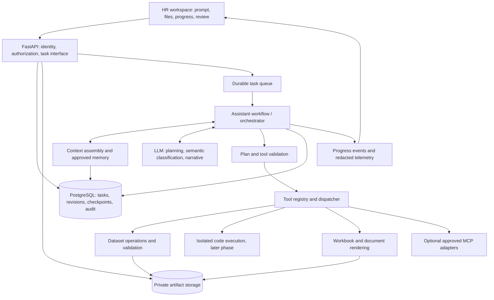

# Thiết kế hệ thống TallyV Assistant

Ngày: 2026-11-04  
Trạng thái: đã triển khai phạm vi MVP gồm data task, công cụ có kiểu dữ liệu, checkpoint SQL, HR review, rule memory và xuất Excel/Word. Hướng dẫn chạy, giới hạn và đối chiếu triển khai nằm tại [docs/assistant.md](assistant.md). Các mục mở rộng trong tài liệu này không mặc nhiên là tính năng đã có.

Thiết kế đích mới cho hướng LangGraph và Code Interpreter được mô tả tại [đặc tả workflow agent](assistant-agent-workflow.md). Khi lập kế hoạch phiên bản tiếp theo, dùng đặc tả đó cho phần điều phối, sandbox, vòng sửa và các gate kiểm chứng; phần hiện trạng Microsoft Agent Framework ở tài liệu này vẫn mô tả implementation đang có.

## 1. Mục tiêu và ý nghĩa của việc tham khảo Microsoft

Assistant nhận yêu cầu nghiệp vụ bằng ngôn ngữ tự nhiên, dữ liệu nguồn và mẫu đầu ra. Hệ thống lập kế hoạch, xử lý dữ liệu qua công cụ, kiểm tra, tạo kết quả và cho HR rà soát/chỉnh sửa. Phân loại nhân sự và thống kê theo năm là một tình huống nghiệm thu, không phải phạm vi duy nhất của sản phẩm.

Tài liệu tham khảo **kiến trúc công khai** của Microsoft Agent Framework và Azure Architecture Center. Đây là thiết kế của TallyV dựa trên các hướng dẫn đó; không phải bản sao kiến trúc nội bộ của một sản phẩm Microsoft, một chứng nhận của Microsoft, hoặc yêu cầu phải dùng Microsoft 365, Copilot, Outlook hay Azure.

Microsoft Agent Framework công khai các khả năng agent, tools, workflows, session/context và tích hợp MCP. Có thể dùng Python cùng backend hiện tại. [Nguồn Microsoft](https://learn.microsoft.com/en-us/agent-framework/overview/)

**Quyết định đề xuất:** một agent điều phối, các bước nghiệp vụ có kiểu dữ liệu rõ ràng, công cụ xử lý độc lập và workflow có trạng thái bền vững. Microsoft khuyến nghị chọn mức phức tạp thấp nhất đáp ứng yêu cầu; multi-agent thêm chi phí, độ trễ và các dạng lỗi phối hợp. [Hướng dẫn chọn orchestration](https://learn.microsoft.com/en-us/azure/architecture/ai-ml/guide/ai-agent-design-patterns)

## 2. Hợp đồng sản phẩm với HR

### Đầu vào

- Prompt mô tả mục tiêu, phạm vi và điều kiện nghiệp vụ.
- Một hoặc nhiều nguồn dữ liệu, ban đầu là XLSX/CSV.
- Mẫu báo cáo nếu cần hoàn thiện tài liệu; ban đầu là DOCX và mẫu XLSX thuộc phạm vi đã kiểm thử.
- Quy tắc/danh mục đã được xác nhận, nếu công việc cần phân loại hoặc diễn giải nghiệp vụ.

Không bắt buộc HR biết công thức, Python, tên tool hoặc tên cột kỹ thuật. Hệ thống đề xuất mapping bằng ngôn ngữ dễ hiểu và hỏi khi việc chọn sai có thể thay đổi ý nghĩa kết quả.

### Đầu ra

- File dữ liệu đã xử lý, gồm các cột bổ sung khi prompt yêu cầu.
- Bảng tổng hợp, kiểm tra và danh sách các trường hợp cần HR rà soát.
- Báo cáo theo mẫu, nếu được yêu cầu.
- Giải thích ngắn về cách làm, phạm vi tính, những giả định đã được xác nhận và mục chưa hoàn tất.
- Dấu vết từ số liệu/nội dung báo cáo về dữ liệu nguồn và phiên bản quy tắc.

Hệ thống tự thực hiện các thao tác tạo bản nháp nằm trong yêu cầu. Chỉ hỏi thêm khi thiếu quyết định nghiệp vụ, quyền cần thiết hoặc khả năng thực thi. Không bắt HR duyệt từng lời gọi công cụ nội bộ.

Các thao tác xuất bản, ghi đè nguồn dùng chung hoặc cập nhật hệ thống nghiệp vụ là hành động riêng, chỉ xuất hiện khi được đưa vào phạm vi sản phẩm và cấp quyền rõ ràng. Tạo/tải bản nháp không đồng nghĩa phát hành báo cáo.

## 3. Quy trình nghiệp vụ chuẩn

| Bước | Hệ thống làm gì | HR nhìn thấy gì | Điều kiện đi tiếp |
| --- | --- | --- | --- |
| 1. Tiếp nhận | Gắn nguồn và mẫu với một task; tạo snapshot có checksum | File đã nhận, mục tiêu công việc | Nguồn có quyền truy cập và đúng định dạng |
| 2. Khảo sát | Đọc sheet, bảng, cột, kiểu dữ liệu, công thức, vùng dữ liệu và bố cục mẫu | Phạm vi nguồn được chọn, các lỗi đầu vào quan trọng | Xác định được dữ liệu liên quan; không cắt bớt âm thầm |
| 3. Hiểu nghiệp vụ | Trích xuất mục tiêu, đơn vị đếm, điều kiện chọn và đầu ra cần tạo | Cách Assistant hiểu yêu cầu | Các quyết định ảnh hưởng kết quả đã rõ |
| 4. Lập kế hoạch | Tạo các bước có phụ thuộc, tool, đầu vào và điều kiện kiểm tra | Kế hoạch ngắn, có thể xem chi tiết | Kế hoạch hợp lệ và có công cụ hỗ trợ |
| 5. Thực thi | Tạo bản dữ liệu làm việc, chạy các bước và lưu kết quả trung gian | Tiến độ thật theo bước, kết quả có thể kiểm tra | Mỗi bước trả kết quả hợp lệ |
| 6. Làm rõ | Tạm dừng phần cần quyết định; nhận sửa mapping/quy tắc từ HR | Câu hỏi cụ thể và các dòng liên quan | HR làm rõ hoặc xác nhận cách xử lý các dòng chưa rõ |
| 7. Kiểm tra | Đối chiếu phạm vi, số dòng, phép tính, các nguồn và yêu cầu ban đầu | Bảng thống kê và các vấn đề còn lại | Đủ điều kiện tạo đầu ra hoàn chỉnh |
| 8. Hoàn thiện mẫu | Điền số liệu đã tính, tạo bảng/đoạn nhận xét và kiểm tra tài liệu | Excel đã xử lý và báo cáo nháp | Không còn trường bắt buộc chưa có dữ liệu |
| 9. Review/chỉnh sửa | Lưu chỉnh sửa, tăng revision và chạy lại các phần bị ảnh hưởng | So sánh trước/sau, kết quả cập nhật | HR kiểm tra đúng revision hiện tại |
| 10. Xuất kết quả | Đóng gói các artifact cùng phiên bản | Tải riêng hoặc tải cả bộ | Các file có manifest và trạng thái chất lượng rõ ràng |

Một task có thể chỉ yêu cầu xử lý Excel mà không cần mẫu Word. Đường đi được chọn theo mục tiêu, không bắt buộc mọi task đi qua bước tạo báo cáo.

## 4. Kiến trúc tổng thể



### Trách nhiệm từng module

| Module | Interface chính ở mức thiết kế | Trách nhiệm |
| --- | --- | --- |
| Task | `submit`, `get`, `respond`, `cancel`, `revise` | Vòng đời yêu cầu, quyền sở hữu, snapshot và revision |
| Source inspection | `inspect_sources` | Nhận diện cấu trúc, phạm vi đọc và những khả năng cần để xử lý |
| Context | `assemble_context` | Chọn thông tin cần cho bước hiện tại, theo quyền và ngân sách token |
| Planning | `propose_plan`, `validate_plan` | Chuyển yêu cầu thành kế hoạch có thể thực thi và phát hiện bước chưa hỗ trợ |
| Orchestration | `start`, `resume` | Chạy các bước, checkpoint, hỏi HR, giới hạn số vòng và khôi phục |
| Tools | `describe`, `execute` | Thực thi thao tác với dữ liệu/file; kiểm tra tham số và quyền phía runtime |
| Validation | `validate_result` | Kiểm tra dữ liệu, số liệu, tính đầy đủ và liên kết nguồn |
| Artifacts | `render`, `preview`, `revise`, `export` | Tạo và quản lý Excel/Word cùng nguồn và phiên bản |
| Memory | `retrieve`, `propose`, `approve`, `retire` | Quy tắc và sở thích dùng lại có phạm vi, lịch sử và cơ chế thu hồi |

LLM không phải nơi lưu trạng thái chính thức, cũng không phải bộ máy tính số liệu. Backend thực thi kế hoạch đã kiểm tra. Không truyền session database, credential hoặc đường dẫn máy chủ cho model.

## 5. Lựa chọn orchestration và runtime

Đề xuất dùng **Microsoft Agent Framework Python** cho phần workflow/agent khi triển khai kiến trúc này, nếu phiên bản được chọn vượt qua bài thử checkpoint, resume và tool calling. Khóa phiên bản SDK và lưu kết quả bài thử trước khi triển khai. Đây là lựa chọn triển khai, không phải điều kiện để kiến trúc được gọi là tốt.

- Một agent có thể được gọi nhiều lần với vai trò lập kế hoạch, phân loại và viết thuyết minh; không cần tạo nhiều agent tự trị cho mỗi vai trò.
- Workflow kiểm soát trình tự bên ngoài; bên trong, planner có thể đề xuất một đồ thị bước thay đổi theo task.
- Các bước đọc/tính/ghi file dùng hàm xác định khi đã có thuật toán rõ.
- Một bộ kiểm tra bằng code là bắt buộc; một model phản biện có thể bổ sung nhưng không thay thế đối chiếu số liệu.
- LangGraph là lựa chọn thay thế cho cùng trách nhiệm. Không chạy đồng thời LangGraph và Agent Framework để điều phối cùng một task.
- Framework chạy trong hạ tầng ứng dụng; không mặc định phải thuê dịch vụ agent được quản lý hoặc dùng model cloud.

Microsoft công khai cơ chế chờ phản hồi người dùng và checkpoint để tiếp tục workflow. Việc lưu checkpoint bền vững phải được cấu hình; một ví dụ dùng bộ nhớ tiến trình không đáp ứng yêu cầu phục hồi sau restart. [Human input](https://learn.microsoft.com/en-us/agent-framework/workflows/human-in-the-loop), [Checkpoints](https://learn.microsoft.com/en-us/agent-framework/workflows/checkpoints)

PostgreSQL tiếp tục là nơi lưu trạng thái nghiệp vụ của TallyV. Nếu dùng nó cho checkpoint của framework thì cần kiểm chứng hoặc viết adapter; tài liệu này không khẳng định SDK đã có sẵn PostgreSQL checkpoint provider. Bằng chứng và các giới hạn từ tài liệu Microsoft được ghi riêng trong [ghi chú nghiên cứu](assistant-microsoft-research.md).

### Trạng thái task đề xuất

```text
RECEIVED -> INSPECTING -> PLANNING -> EXECUTING -> VALIDATING
                                                   |
                                                   +-> RENDERING -> READY_FOR_REVIEW -> APPROVED

Any active state -> NEEDS_INPUT -> resume affected stage
Any active state -> FAILED or CANCELLED
READY_FOR_REVIEW / APPROVED -> new revision -> affected stages -> READY_FOR_REVIEW
```

`APPROVED` chỉ có nghĩa HR đã kiểm tra một bộ kết quả cụ thể. Bản export lưu tham chiếu task revision và artifact revisions riêng. Sửa đầu vào/quy tắc/tài liệu tạo revision mới và làm mất hiệu lực xác nhận ở các đầu ra bị ảnh hưởng.

### Phục hồi và tính nhất quán

- Checkpoint chứa `task_id`, revision, plan version, bước đã xong, con trỏ dataset/artifact, câu hỏi chờ trả lời và budget đã dùng.
- Mỗi lần gọi tool có ID, phiên bản tool, checksum đầu vào, rule version và attempt riêng.
- Chỉ ghi nhận bước hoàn tất sau khi đầu ra đã được lưu và tham chiếu kết quả được commit.
- Công cụ có tác dụng ghi dùng idempotency key. Checkpoint không tự bảo đảm side effect chỉ xảy ra một lần.
- Nếu timeout khi ghi vào hệ thống bên ngoài mà chưa rõ kết quả, lưu `OUTCOME_UNKNOWN` ở tool call và đối chiếu trước khi gửi lại.
- Thay đổi quy tắc phân loại làm mất hiệu lực bước phân loại và các bước phụ thuộc: thống kê, báo cáo, preview và review.
- Retry lỗi tạm thời có giới hạn; thiếu nghiệp vụ chuyển sang hỏi HR; không đổi cách đếm để làm cho task chạy được.
- Thiết lập ngân sách vòng lặp, tool calls, thời gian và token cho từng task; hết budget trả trạng thái và phần việc đã làm được.

## 6. Kế hoạch có cấu trúc và công cụ tổng quát

Planner tạo một execution plan có schema và version, không trả một đoạn văn để worker tự suy đoán. Mỗi bước gồm:

```json
{
  "id": "count_by_year_and_category",
  "tool": "aggregate_rows",
  "tool_version": "1",
  "depends_on": ["classify_roles"],
  "inputs": {
    "dataset_ref": "step:classify_roles.output",
    "group_by": ["year", "category"],
    "measure": {"operation": "count_rows"}
  },
  "checks": ["reconcile_selected_rows", "require_resolved_categories"]
}
```

Ví dụ trên minh họa contract, chưa phải schema đã được cài đặt. Các cột được ánh xạ qua catalog nguồn; không mặc định Excel người dùng có cột tên tiếng Anh.

Kế hoạch đầy đủ còn giữ mục tiêu, nguồn, điều kiện chọn, cách đếm, phạm vi năm, danh mục, output specification, câu hỏi chưa giải quyết và các bước bắt buộc để đáp ứng prompt. Mỗi đầu ra yêu cầu phải có bước tạo và kiểm tra tương ứng. Thiếu khả năng thì trả gap rõ ràng.

### Bộ công cụ ban đầu

| Nhóm | Khả năng |
| --- | --- |
| Khảo sát | Liệt kê nguồn/sheet/bảng, đọc schema, profile dữ liệu, nhận diện vùng mẫu |
| Chuẩn hóa | Chuyển kiểu có kiểm soát, chuẩn hóa chuỗi, thêm cột dẫn xuất, phát hiện dữ liệu thiếu |
| Phân loại | Áp dụng danh mục/quy tắc; dùng model cho ngữ nghĩa còn lại; giữ trạng thái chưa xác định |
| Biến đổi | Lọc, chọn cột, sắp xếp, ghép dữ liệu theo khóa, reshape/pivot |
| Tổng hợp | Đếm dòng, đếm khác biệt khi được yêu cầu, tổng, tỷ lệ và nhóm theo các chiều |
| Đối chiếu | Kiểm tra tổng, khóa trùng, số dòng sau join, unmatched rows và khác biệt giữa hai nguồn |
| Tạo đầu ra | Xuất XLSX, điền DOCX, tạo bảng và biểu đồ thuộc phạm vi được hỗ trợ |
| Kiểm tra file | Đọc lại file xuất, đối chiếu số liệu/placeholder/công thức và tạo preview |

Không hardcode một hàm riêng cho mỗi báo cáo HR. Case nghiệp vụ được biểu diễn bằng tổ hợp công cụ và quy tắc. Các recipe đã kiểm chứng có thể dùng lại như gợi ý kế hoạch, với version và kiểm tra đầu vào.

### Ranh giới giữa công cụ khai báo và code do AI tạo

Giai đoạn đầu ưu tiên công cụ có tham số rõ và biểu thức được giới hạn. Với tác vụ chưa biểu diễn được, chỉ thêm `run_analysis_code` sau khi có sandbox thực sự:

- Tiến trình hoặc môi trường cô lập riêng; không dùng `eval`/`exec` trực tiếp trong API hay worker có credential.
- Chỉ cấp snapshot đầu vào theo quyền; xuất vào vùng output riêng của task.
- Giới hạn CPU, RAM, thời gian, dung lượng và thư viện; mạng mặc định bị chặn.
- Không mount secret, Docker socket hoặc thư mục ứng dụng.
- Lưu code hash, môi trường và output manifest để truy vết; kiểm tra đầu ra độc lập.
- Một bộ lọc chuỗi hoặc kiểm tra AST không được xem là sandbox.

Đây là thiết kế kiểm soát thực thi của TallyV. Microsoft cũng đặt kiểm soát việc gọi tool và chống prompt injection trong hướng dẫn thiết kế ứng dụng AI. [Application design](https://learn.microsoft.com/en-us/azure/well-architected/ai/application-design)

## 7. Context, memory và knowledge

### Context ở mỗi bước

Context builder đưa cho model mục tiêu hiện tại, các quyết định HR đã chốt, schema nguồn, các quy tắc liên quan, kết quả ngắn của những bước trước và danh sách công cụ được phép dùng. Không gửi toàn bộ workbook và lịch sử ở mọi lần gọi.

Dữ liệu đầy đủ được công cụ đọc và xử lý. Phân loại ngữ nghĩa được chạy theo các chức danh khác biệt hoặc theo lô có ID ổn định; không lấy vài dòng mẫu rồi áp kết luận như thể đã xét toàn bộ nguồn. Nếu kết quả phụ thuộc thông tin khác ngoài tên chức danh, classification key phải bao gồm những thông tin đó.

- Context compaction tóm tắt hội thoại nhưng không thay thế task state, số liệu, quyết định HR hoặc source references.
- Giữ nguyên mục tiêu, điều kiện lọc, đơn vị đếm và các quyết định đang chờ trong dữ liệu có cấu trúc.
- Mỗi model call lưu manifest thông tin nguồn/rule version đã được sử dụng, không cần ghi toàn bộ nội dung nhạy cảm vào log.
- File, ô Excel, phần nhận xét và template được xem là dữ liệu nguồn, không phải chỉ thị có quyền thay đổi công cụ hoặc chính sách.

Microsoft Agent Framework có context providers để nạp thông tin trước lời gọi và xử lý dữ liệu sau lời gọi; TallyV cần cung cấp implementation phù hợp với quyền và dữ liệu của mình. [Context providers](https://learn.microsoft.com/en-us/agent-framework/agents/conversations/context-providers)

### Các loại thông tin lưu lại

| Loại | Ví dụ | Cách quản lý đề xuất |
| --- | --- | --- |
| Task state | Sheet được chọn, cách đếm, bước đang chạy, câu hỏi chờ trả lời | Theo task/revision; checkpoint bền vững |
| Conversation history | Prompt, phản hồi HR, giải thích của Assistant | Theo owner/workspace; tóm tắt có nguồn |
| Business memory | Quy tắc chức danh thuộc nhóm nào, định nghĩa chỉ tiêu | Chỉ dùng lại sau xác nhận; có scope/version/effective period |
| Preferences | Cách trình bày số, mẫu báo cáo ưu tiên | Theo người dùng/đơn vị; có thể sửa/xóa |
| Knowledge | Quy định, danh mục chức danh và hướng dẫn nghiệp vụ | Nguồn chính thức, phạm vi truy cập và hiệu lực rõ ràng |
| Artifacts and evidence | Workbook nguồn, dataset dẫn xuất, report, checks | Snapshot/version/checksum; retention theo chính sách |

Không tự ghi mọi suy đoán của model thành business memory. Quy tắc mới đi qua `proposed -> approved -> active -> retired`; task có thể dùng quyết định tạm thời chỉ trong phạm vi của nó. Xung đột giữa quy tắc đang có và yêu cầu mới được đưa ra làm rõ.

PostgreSQL cùng kho file hiện tại đủ cho trạng thái và danh mục ban đầu. Chỉ thêm tìm kiếm ngữ nghĩa khi cần tra cứu tài liệu/quy tắc lớn. Vector search phục vụ tìm thông tin liên quan; số lượng nhân sự vẫn được tính trên toàn bộ dataset thuộc phạm vi đã xác nhận.

## 8. Ví dụ xuyên suốt: phân loại và thống kê nhân sự

### Yêu cầu đã được xác nhận trong cuộc trao đổi

- Đếm số dòng theo năm và nhóm/chức danh; không tự loại trùng theo mã nhân viên.
- Năm và chức danh/nhóm đã có trong nguồn.
- HR muốn gắn phân loại với từng dòng rồi đưa số lượng vào báo cáo.
- Không tự suy ra tình trạng làm việc cuối năm từ danh sách hiện tại.

### Cách xử lý

1. Chọn đúng sheet/vùng dữ liệu và ánh xạ cột năm, chức danh, thông tin người.
2. Nếu có nhóm đã được xác nhận thì dùng nhóm đó; nếu chỉ có chức danh thì tạo cột phân loại dẫn xuất.
3. Dùng quy tắc đã được xác nhận trước; dùng model để đề xuất nhóm cho các giá trị còn lại.
4. Ví dụ “Bác sĩ nội tim mạch” đề xuất nhóm “Bác sĩ”; “Điều dưỡng nhi” đề xuất “Điều dưỡng”.
5. “Trưởng khoa hồi mê cấp cứu” thuộc nhóm “Bác sĩ” khi có quy tắc hoặc xác nhận của HR cho phạm vi đó; không coi mọi chức vụ trưởng khoa là bằng chứng chuyên môn bác sĩ.
6. Thêm các cột `category`, `classification_status`, `rule_id`, `reason`, giữ source row ID và giá trị nguồn.
7. Đưa các dòng chưa rõ, năm không hợp lệ hoặc dữ liệu xung đột vào danh sách review; không tự biến thành 0 hoặc tự bỏ qua.
8. Tính count theo nhóm/năm. Dòng trùng vẫn tính theo yêu cầu; cảnh báo dữ liệu trùng được hiển thị riêng, không làm thay đổi measure.
9. Đối chiếu: số dòng được chọn = số dòng đã phân nhóm + số dòng chưa giải quyết/được loại theo quyết định có ghi nhận. Không cộng tổng nhiều năm rồi gọi là số người duy nhất.
10. Điền báo cáo bằng metric references: mỗi ô/chỉ tiêu lấy đúng kết quả tính đã định danh. Model chỉ viết nhận xét dựa trên các metric được cấp.
11. Nếu HR sửa một phân loại, tăng revision, tính lại các nhóm liên quan, tạo lại phần báo cáo phụ thuộc và bỏ trạng thái review cũ.

### Chất lượng và truy vết

- Mỗi kết quả phân loại giữ chức danh gốc, nhóm đề xuất/xác nhận, lý do, model/rule version và người xác nhận nếu có.
- Không dùng độ tự tin tự chấm của model như bằng chứng phân loại đúng; hiệu quả phải được đo trên bộ ví dụ HR xác nhận.
- Mỗi chỉ tiêu giữ `metric_id`, điều kiện chọn, measure, phạm vi năm và source row references.
- Số liệu trong báo cáo phải khớp dataset và bảng tổng hợp. Sửa trực tiếp số trên Word là override có đánh dấu và cần đối chiếu lại, không trở thành dữ liệu nguồn âm thầm.

## 9. Tạo Excel và báo cáo theo mẫu

Tách **kế hoạch nội dung** khỏi **render tài liệu**. LLM đề xuất mapping giữa chỉ tiêu/đoạn văn và vị trí mẫu; renderer chèn giá trị đã kiểm tra.

- Mẫu có placeholder, named range hoặc content control: dùng mapping ổn định.
- Mẫu chưa có trường rõ: khảo sát bảng/nhãn, đề xuất mapping, hỏi HR nếu có nhiều vị trí có thể điền; không hứa hỗ trợ mọi bố cục Word/Excel ngay.
- Bảng thống kê nhiều dòng cần binding bảng động; điền từng placeholder đơn lẻ không đủ.
- Thuyết minh phải chỉ ra các metric được dùng; không để model tự tính lại con số từ trí nhớ.
- File xuất cần được đọc lại, kiểm tra trường chưa điền, tổng, vị trí bảng và preview bố cục.
- Preview nội dung hiện tại của Assistant chưa thay thế kiểm tra layout trang Word; phải nghiệm thu cả file mở trong ứng dụng đích.
- Mỗi bộ kết quả có manifest liên kết dataset revision, rule version, metric version và document revision.

### Hai cách tính phải phân biệt rõ

1. **Tính dữ liệu bằng Python rồi ghi kết quả:** phù hợp nhiều tác vụ phân loại, ghép và thống kê. File xuất có thể là một snapshot số liệu.
2. **Tạo công thức và tính lại bằng engine được hỗ trợ:** cần khi HR muốn thay đổi nguồn trong workbook và kết quả tự cập nhật, hoặc mẫu phụ thuộc công thức Excel.

Không ghi công thức rồi đánh dấu thành công nếu chưa tính/kiểm tra kết quả. Nếu MVP chưa có engine cho một công thức hoặc tính năng, phải thông báo giới hạn hoặc xuất giá trị snapshot khi HR chấp nhận. Không hứa kết quả tự cập nhật khi file chỉ chứa giá trị đã tính một lần.

## 10. Tools và MCP

Tất cả tools đi qua một dispatcher có schema, kiểm tra quyền, budget, timeout và ghi nhật ký. Tool descriptions giúp model chọn thao tác; metadata của tool không thay thế enforcement ở runtime.

MCP là adapter tùy chọn để kết nối các công cụ được cung cấp qua giao thức chung. Các hàm đọc/tính/render nội bộ có thể gọi trực tiếp, không cần chuyển thành MCP server ngay. Không tạo hàng loạt server chỉ vì sử dụng agent.

Nếu dùng MCP: danh sách server/tools được quản lý, quyền theo task/owner, input/output được validate, không để model tự thêm server từ URL trong tài liệu. Credential thuộc runtime và không có trong context. Tiến độ và provenance vẫn được chuẩn hóa vào task của TallyV.

Microsoft Agent Framework có tích hợp tools và MCP; việc cấp quyền, đảm bảo idempotency và kiểm tra kết quả vẫn là trách nhiệm ứng dụng. [Framework overview](https://learn.microsoft.com/en-us/agent-framework/overview/)

## 11. Giao diện HR

Giữ trải nghiệm một workspace, gồm:

- Hội thoại: mục tiêu, câu hỏi làm rõ và yêu cầu sửa bằng prompt.
- Tiến độ: tên bước dễ hiểu, trạng thái, lý do chờ, khả năng hủy/thử lại.
- Kết quả: Excel đã xử lý, bảng thống kê và báo cáo nằm trong cùng bộ phiên bản.
- Review: lọc các trường hợp cần xem, sửa phân loại theo dòng hoặc theo quy tắc có scope rõ, xem nguồn của chỉ tiêu.
- So sánh revision: thay đổi dữ liệu, số liệu và báo cáo; tránh hiển thị một file cũ như kết quả mới.

Một prompt có thể tạo nhiều artifact. Kết quả nên có cảnh báo cụ thể như “12 dòng cần xác nhận nhóm” thay vì chỉ hiển thị “AI hoàn tất”. Kết quả sơ bộ có thể xem trước; báo cáo chính thức không được trình bày là đầy đủ nếu còn lỗi ảnh hưởng chỉ tiêu.

## 12. Lưu trữ, phân quyền và vận hành

### Các thực thể đề xuất

| Thực thể | Dữ liệu chính |
| --- | --- |
| Task / task revision | Owner/workspace, yêu cầu chuẩn hóa, scope, output specification và trạng thái |
| Source snapshot | File ID, checksum, sheet/range, thời điểm nhận và quyền |
| Execution plan / step | Schema version, tool version, dependencies và input/output references |
| Tool call / checkpoint | Attempt, idempotency key, trạng thái, budget và điểm khôi phục |
| Dataset version / row lineage | Schema, số dòng, nguồn từng dòng và biến đổi |
| Classification / rule version | Nhóm, evidence, phạm vi/hiệu lực, trạng thái và quyết định HR |
| Metric / validation issue | Giá trị, filter/measure, row references và kết quả đối chiếu |
| Artifact / review | File, revision, metric bindings, checksum và người kiểm tra |
| Audit / outbox event | Ai làm gì trên revision nào; sự kiện chờ enqueue/thông báo |

Đây là logical model. Khi triển khai mới quyết định bảng/JSON nào phù hợp và tạo migration Alembic; tài liệu này không tạo bảng hay sửa schema hiện tại.

### Yêu cầu vận hành

- Tái sử dụng FastAPI, PostgreSQL, kho local/S3 và hàng đợi hiện có trước khi thêm hạ tầng.
- Không giữ transaction database mở trong toàn bộ lượt gọi model hoặc công việc dài. Mỗi step lưu kết quả bằng transaction ngắn, gắn artifact references và event/outbox phù hợp.
- Claim/lease và heartbeat cần phù hợp công việc dài; resume không chỉ chạy lại nguyên task từ đầu.
- Khi chạy đồng thời, task Assistant có giới hạn tài nguyên riêng để không chặn công việc chấm công.
- Nếu mở rộng queue/worker, kiểm tra lại cơ chế advisory lock hiện tại; không tăng replica một cách máy móc.
- Theo dõi trace/task/step ID, model/tool version, duration, token/cost nếu có, retries, issues và kết quả review; không log token đăng nhập hoặc toàn bộ hồ sơ nhân sự.
- Có cơ chế xóa dữ liệu dẫn xuất, memory và checkpoint theo cùng chính sách retention; thử restore trước khi nghiệm thu vận hành.

### Truy cập và dữ liệu

- Kiểm tra quyền với từng nguồn, dataset, task, rule và artifact; user ID/workspace không lấy từ lời gọi tool do model tự đặt.
- Nguồn và đầu ra lưu riêng; mọi thay đổi truy được về nguồn và revision.
- Chỉ nạp business memory thuộc đúng đơn vị/người dùng/phạm vi hiệu lực.
- Việc chọn model và nơi chạy là quyết định triển khai theo chính sách dữ liệu. Không tự chuyển từ model nội bộ sang dịch vụ ngoài khi có lỗi.
- MVP tiếp tục dùng dữ liệu giả; chuyển sang dữ liệu bệnh viện cần đánh giá và phê duyệt theo quy trình của viện. Dùng kiến trúc Microsoft không tự chứng minh tuân thủ JCI hoặc mọi yêu cầu bảo mật.

## 13. Khác biệt so với Assistant hiện tại

Đối chiếu tại thời điểm đọc code, không phải các chức năng vừa được triển khai:

| Hiện tại | Cần thiết cho mục tiêu mới |
| --- | --- |
| Prompt + đúng một mẫu và một nguồn | Task có nguồn/mẫu tùy theo mục tiêu, nhiều nguồn khi cần ghép |
| Plan mapping/filter/rewrites/corrections cho điền hồ sơ | Execution plan nhiều bước, dependencies, output contracts và capability checks |
| Worker xử lý một generation run | Step checkpoints, resume có phạm vi, hủy và retry có kiểm soát |
| Đọc tối đa 200 bản ghi theo giới hạn MVP | Profile/chunk/budget rõ; nâng giới hạn sau benchmark, không cắt dòng âm thầm |
| Điền một DOCX cho mỗi bản ghi | Dataset transformations, phân loại từng dòng, metric tables và báo cáo tổng hợp |
| Ngữ cảnh hội thoại nối yêu cầu bổ sung | Structured task state, context assembly, memory có scope và version |
| Preview đoạn văn và cờ đã kiểm tra | Review dữ liệu, trace số liệu, layout preview và review gắn revision |
| Các hàm xử lý được gọi cố định | Tool registry, schema validation và runtime policy |

Các điểm tái sử dụng chính: `app/assistant/services/conversations.py`, `documents.py`, `artifacts.py`, owner checks, private storage, models hội thoại và worker hooks. Phần `planner.py` và `workflow.py` cần mở rộng có kiểm soát, giữ luồng điền mẫu cũ như một khả năng riêng có kiểm thử hồi quy.

### Vị trí code đề xuất khi bắt đầu triển khai

```text
app/assistant/
  api/                  # Task, progress, review and artifact HTTP interfaces
  schema/               # Task, plan, tool, dataset and validation contracts
  services/
    tasks.py            # Task lifecycle and transaction ownership
    orchestration.py    # Workflow integration and step scheduling
    context.py          # Context assembly and approved memory retrieval
    planner.py          # Structured planning and clarification
    validation.py       # Independent result checks
    artifacts.py        # Rendering, revisions and export
    tools/
      registry.py       # Tool descriptions, schema and dispatch
      datasets.py       # Data transformations and aggregation
      classification.py # Role/category assignment with evidence
      documents.py      # Workbook/report generation tools
  crud/                 # Queries, locks and persisted state access
  models/               # SQLAlchemy mappings
  jobs.py               # Shared worker lifecycle integration
```

Chỉ tạo file/module khi có hành vi cụ thể; không thêm lớp chuyển tiếp hoặc nhiều adapter giả định. Code, identifiers và comments dùng tiếng Anh; chuỗi giao diện nằm trong catalog bản địa hóa.

## 14. Lộ trình và tiêu chí hoàn thành

### Giai đoạn 1: một luồng end-to-end có thể kiểm chứng

- Chạy một agent điều phối với công cụ đọc/biến đổi/phân loại/count/render.
- Lưu task, step results, checkpoint và source lineage.
- Hoàn thiện case phân loại nhân sự -> thêm cột -> count theo năm -> điền DOCX.
- Hỏi/sửa các chức danh chưa rõ, tính lại kết quả phụ thuộc và review đúng revision.
- Dùng dữ liệu giả và model đạt bài thử; không yêu cầu tài khoản Microsoft 365.

**Điều kiện hoàn thành:** kết quả đếm khớp dữ liệu chuẩn, không bỏ dòng, mỗi chỉ tiêu truy được nguồn, dừng/chạy tiếp đúng sau khi HR trả lời và retry không tạo bộ kết quả trùng.

### Giai đoạn 2: chứng minh tổng quát hóa

- Dùng cùng contract/tools cho ghép hai danh sách, đối chiếu thay đổi, lọc theo điều kiện, pivot và kiểm tra thiếu/trùng.
- Bổ sung mẫu XLSX, bảng động trong DOCX và kiểm tra layout theo mẫu thực tế.
- Bổ sung công thức có kiểm tra recalculation; chỉ bổ sung sandbox khi công cụ khai báo không đủ.
- Hoàn thiện business memory có phê duyệt, scope và hiệu lực.

**Điều kiện hoàn thành:** nhiều bài toán khác nhau dùng chung bộ công cụ, không cần một endpoint hoặc hàm nghiệp vụ riêng cho mỗi prompt. Yêu cầu ngoài khả năng được giải thích rõ, không trả kết quả giả.

### Giai đoạn 3: vận hành và mở rộng doanh nghiệp

- Benchmark kích thước dữ liệu, tài nguyên, model, latency và chi phí với khối lượng HR thực tế.
- Hoàn thiện phân quyền, quota, telemetry, retention, backup/restore và phục hồi job dài.
- Thêm MCP hoặc adapter hệ thống ngoài khi có yêu cầu và quyền cụ thể.
- SAP là một hướng tích hợp riêng sau này; không phải điều kiện để hoàn thành Assistant xử lý Excel/Word.

### Ma trận nghiệm thu

| Nhóm | Kiểm chứng bắt buộc |
| --- | --- |
| Hiểu yêu cầu | Nhiều cách diễn đạt cho cùng nghiệp vụ; giữ đúng filter, measure và output; hỏi khi mơ hồ |
| Phân loại | Bộ ví dụ HR xác nhận, chức danh không rõ, các quy tắc xung đột và phạm vi hiệu lực |
| Tính toán | Count dòng đúng tuyệt đối trên bộ chuẩn; không tự dedupe; blank/year lỗi hiển thị rõ |
| Phạm vi dữ liệu | Đúng sheet/range, dòng ẩn và dòng tổng có chính sách rõ, nhiều nguồn không bị nhân dòng sau join |
| Truy vết | Mỗi chỉ tiêu/nhóm truy được nguồn và phiên bản; báo cáo khớp bảng dữ liệu đã xử lý |
| Chỉnh sửa | Sửa một nhóm làm cập nhật thống kê và báo cáo; review cũ mất hiệu lực |
| Tài liệu | Đúng ô/trường/bảng, không còn placeholder bắt buộc, đọc lại số liệu và kiểm tra layout |
| Context/memory | Không dùng nhầm quy tắc của người/đơn vị khác; compaction không làm mất quyết định HR |
| Phục hồi | Restart giữa bước, timeout, cancel, retry và resume không nhân đôi kết quả |
| Tool security | File có chỉ thị giả không đổi quyền; tool sai schema/phạm vi bị chặn; sandbox không đọc secret |
| Model quality | JSON/tool calling thực tế, unsupported tasks, thiếu bằng chứng và model unavailable |
| Vận hành | Tải dữ liệu đại diện, giới hạn tài nguyên, logs được giảm nhạy cảm và backup/restore |

Chỉ tiêu phân loại và hiệu năng phải được chốt trên bộ dữ liệu HR đã gán nhãn; không công bố tỷ lệ chính xác hoặc thời gian chạy khi chưa đo. Microsoft Well-Architected yêu cầu đánh giá cả deterministic logic lẫn luồng model/tool theo tình huống thực tế. [Testing and evaluation](https://learn.microsoft.com/en-us/azure/well-architected/ai/test)

## 15. Những quyết định cần có trước khi viết implementation

1. Bộ dữ liệu giả và mẫu báo cáo đại diện, cùng kết quả HR mong muốn để nghiệm thu.
2. Danh mục phân loại, quy tắc không rõ và người có quyền xác nhận quy tắc dùng lại.
3. Phạm vi tính theo dòng/năm ở case đầu; các measure khác chỉ được dùng khi task yêu cầu.
4. Quy mô nguồn, kiểu công thức/bố cục cần hỗ trợ và yêu cầu file tự cập nhật sau export hay chỉ là snapshot.
5. Model và môi trường chạy được phép dùng, qua bài thử tool calling và chất lượng trên dữ liệu giả.
6. Phiên bản orchestration SDK và storage checkpoint được kiểm chứng.
7. Mức độ code execution thực sự cần trong giai đoạn đầu; không thêm sandbox giả chỉ để có tính năng.

Tài liệu này là cơ sở thiết kế và phân chia công việc triển khai; việc bắt đầu viết code là một bước tiếp theo riêng.
