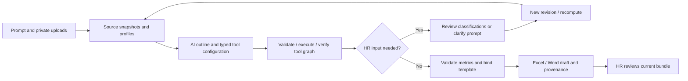

# TallyV Assistant

Assistant supports prompt-driven data work and document drafting inside TallyV. It shares authentication, private file storage and the job queue with the attendance module. It does not require Microsoft 365, Outlook, Copilot, Azure or SAP.

The implementation follows the public Microsoft agent/workflow patterns described in [the system design](assistant-system-design.md), using `agent-framework-core==1.24.0` for typed tool execution graphs. Application-level SQL receipts persist progress between those graphs. This is not a Microsoft certification or an implementation of Microsoft's private product internals.

The proposed next iteration using LangGraph, a self-hosted coding agent and isolated execution is specified in [the agent workflow and acceptance contract](assistant-agent-workflow.md). That document describes a target architecture; code execution and LangGraph are not enabled by the current implementation.

## Run and try

1. Install dependencies: `venv/bin/python -m pip install -r requirements.txt`.
2. Apply additive migrations: `venv/bin/python -m alembic upgrade head`.
3. Build the UI: `npm --prefix frontend run build`.
4. Start the configured local Ollama model, then restart the API and TallyV worker. The worker entry point is `venv/bin/python -m app.worker`; do not run a separate DraftV worker.
5. Open `/?app=assistant`, choose the data-analysis sample, and send its prompt. The sample contains eight synthetic rows, including a deliberate duplicate and an ambiguous management role.
6. Review classification suggestions, confirm the ambiguous role, and continue. Open the generated workbook and Word report, trace grouped rows to their source files, then mark the current output bundle reviewed.

The older document-drafting sample remains available. It generates individual documents from records and supports its original clarification, editing and review workflow.

## Data workflow



Each queue claim executes one phase and releases its SQL transaction before file/model work. A retry keeps completed receipts; a cancellation prevents a late model/tool result from publishing artifacts. The application stores model-call consumption before calling the model. Time, model-call, row, file and step budgets are bounded.

The planner selects operations, then configures one operation at a time against the actual input schema. Tools include filtering, classification, grouped counts/sums/means/min/max, many-to-one joins, derived columns, projection, sorting, explicit deduplication, pivoting, replacements, validation and grounded draft commentary. Model-generated Python, SQL and shell commands are not executed. MCP is not required for these internal tools.

Classification is a draft: model suggestions require HR confirmation. Management titles alone do not establish a clinical profession. Only owner-approved memory, explicit quoted prompt mappings (for example `"source role" -> "category"`) and recorded HR decisions can bypass that confirmation. Saving a rule is optional and scoped to the current HR account. Rules can be retired; rule IDs and versions remain in task snapshots.

Counts use source rows unless distinct counting is explicitly requested. Duplicate rows are preserved by default. Blank/invalid grouping values block publication and expose source-linked validation issues. Arithmetic uses Decimal and reconciles grouped row counts. The AI does not compute the reported totals.

## Reports and review

- Sources: XLSX/CSV, plus bounded structured tables supported by the existing TXT/DOCX/text-PDF parser. Each imported sheet is a separate dataset. Hidden rows are included; blank rows are omitted. No silent row truncation.
- Templates: DOCX/TXT and XLSX. Use scalar placeholders such as `{{count_2025}}` and standalone table markers such as `{{summary_table}}`. Labelled Word blanks such as `Selected rows: ....` are normalized into placeholders while preserving fixed wording.
- Automatic fields: `{{total_rows}}`, `{{source_rows}}`, `{{summary_table}}`. For other fields, the model selects IDs from a bounded catalog of computed row counts and summary/single-record cells. The runtime compiles those IDs to exact row/column references. HR can inspect the filled metrics in the task before approving the bundle. Source-record counts and summary-group counts have separate meanings.
- Output: `Analysis.xlsx` with Summary/Details, optional `Report.docx` or `Report.xlsx`, CSV summary, and a ZIP containing files plus plan/provenance and `Lineage.json`.
- Preview: paginated datasets with source file/sheet/row links, exported workbook sheet preview, and Word content preview. These previews are not full Office layout renderers.
- Corrections create a new immutable task revision and recompute the result/report. An older revision's approval becomes stale. Data-bound reports are reviewed as a bundle; direct edits that would desynchronize reported totals are disabled. Legacy standalone documents retain direct editing.

## Configuration

`ASSISTANT_PROCESSING_MODE`, `ASSISTANT_OLLAMA_URL`, `ASSISTANT_OLLAMA_MODEL` and `ASSISTANT_MODEL_TIMEOUT` are independent of attendance classification. Defaults point to an explicitly started local Ollama at port 11435 with `llama3.2:latest`. No model is downloaded automatically. Docker uses `ASSISTANT_DOCKER_OLLAMA_URL`.

Data limits are configured by `ASSISTANT_MAX_DATA_ROWS` (10000), `ASSISTANT_MAX_STEPS` (20), `ASSISTANT_MAX_MODEL_CALLS` (12), and `ASSISTANT_MAX_TASK_SECONDS` (900). Uploads are limited to six files at 15 MB each. Each task supports one optional template. Smaller local models can return invalid plans; the task asks for clarification or reports a retryable model failure instead of silently fabricating a result. `RULE_BASED` retains legacy deterministic drafting but does not emulate AI data-task planning.

## Hybrid Excel workflow

Set `ASSISTANT_PROCESSING_MODE=HYBRID` for new Assistant data tasks. HR attaches one or more values-only XLSX sources and optionally one XLSX or DOCX report template. LangGraph routes work in the existing worker, which stores the next node and receipts in the existing database. By default Qwen3.5 4B describes one sheet per call. TallyV resolves the request with local tools and computes reference outputs. For script generation, OpenRouter receives generated identifiers, fixed column meanings and types, operation names, and fixed repair codes. The original prompt, values, spreadsheet and template names, local model descriptions and diagnostics stay internal. GPT returns Python. The runner sees the authorized tables and actual parameters, and the worker publishes only after exact comparison with the local reference. The script gets at most three attempts. Requests that cannot be expressed or checked with the current typed operations require clarification. OpenRouter uses GPT-5.4 Mini via Azure endpoints eligible for zero data retention.

1. For Docker, [prepare the pinned Qwen weights and start Ollama](../llm-service/README.md). The Compose override connects the API and worker to `http://ollama:11434`. If using an existing native Ollama instead, preload `qwen3.5:4b-q4_K_M` on the endpoint the worker calls.
2. On an internal Linux execution host, configure [Docker with gVisor runsc](https://gvisor.dev/docs/user_guide/quick_start/docker/) and provision the approved `python:3.11-slim` image. The runner uses `--pull=never`. For a pinned local image, set `ASSISTANT_SANDBOX_IMAGE` on the runner host. Start the runner there with `python -m uvicorn scripts.assistant_sandbox:app --host 127.0.0.1 --port 8100 --no-access-log`. Give that process a separate `ASSISTANT_SANDBOX_TOKEN` of at least 32 characters. For a remote worker, expose the runner through internal TLS and restrict access to the worker. The worker uses HTTPS except for loopback development. The worker and sandbox containers do not need a Docker socket mount.
3. In the API and worker environment, set `ASSISTANT_SANDBOX_URL`, the matching `ASSISTANT_SANDBOX_TOKEN`, `OPENROUTER_API_KEY`, and `ASSISTANT_PROCESSING_MODE=HYBRID`. The default `ASSISTANT_OPENROUTER_MODEL` is `openai/gpt-5.4-mini`. Install the updated dependencies, then restart the API and worker. Try a synthetic Excel task before enabling real sources.

For local development with Docker Desktop and Lima, add `compose.assistant-sandbox.local.yaml` to your Compose stack. It uses Lima's loopback port forwarding and reaches the runner at `https://host.docker.internal:8100`. Serve TLS on the runner with a certificate valid for `host.docker.internal`. Put the public CA certificate in `.env.sandbox-ca.pem` and the runner's matching `ASSISTANT_SANDBOX_TOKEN` in `.env.sandbox`. The worker mounts the public CA for HTTPS, and the API uses the URL and token configuration to report whether script execution is configured. For other deployments using an internal CA, point `ASSISTANT_SANDBOX_CA_FILE` at the CA bundle accessible to the worker.


For temporary cloud profiling, set `ASSISTANT_HYBRID_SHEET_PROVIDER=openrouter` and recreate the worker. This routes only sheet and column descriptions through the existing `ASSISTANT_OPENROUTER_MODEL` with Azure and zero-data-retention routing. The profiling request contains column indices, header text, and observed types. It omits file and sheet names, row values, and the user request. Set the provider back to `ollama` to restore local profiling.

With the Outlook overlay already in use, start Ollama and recreate the API and worker with the full set of overlays after setting `ASSISTANT_PROCESSING_MODE=HYBRID` in `.env`:

```sh
docker compose -f compose.yaml -f compose.outlook.yaml -f compose.llm.yaml \
  -f compose.assistant-sandbox.local.yaml --profile llm up -d --build ollama api worker
```

## Persistence and boundaries

Eight `assistant_*` tables are separate from attendance data. `assistant_generation_runs` holds task type, parent revision, plan and bounded state. `assistant_task_steps` stores durable tool receipts; `assistant_business_rules` stores owner-approved rule memory. Artifacts, source files and intermediate snapshots use private storage keys and SHA-256 checksums. All API views/downloads enforce conversation ownership. File contents and model prompts are not included in operational logs.

The MVP works on snapshots. It does not control a live Excel application, recalculate source formulas, run VBA/macros, OCR scanned PDFs, automatically send reports or update SAP. Formula-containing spreadsheets are rejected with an explicit explanation; provide an exported values-only copy. Complex layouts, charts, merged-cell table expansion and unsupported business transformations may need a simpler template or additional tools. Text commentary remains subject to HR review even when its numeric references are checked.

Before hospital deployment, organizational access rules, retention, model hosting, infrastructure controls and the relevant compliance requirements require a separate review. Local model execution alone is not a certification of compliance.

## Verification

- `venv/bin/python -m pytest -q`: application, ownership, queue, migration, tool arithmetic, classification corrections, report binding, retries and cancellation tests.
- On the Linux runner with gVisor and the local Python image, run `ASSISTANT_RUN_SANDBOX_TEST=1 python -m pytest -q tests/test_assistant_hybrid.py -k real_sandbox` to check that a script can process a fixture but cannot reach the network or read runner credentials.
- `npm --prefix frontend run build`: TypeScript and production bundle.
- `venv/bin/python -m alembic check`: schema/metadata consistency against the configured database.
- `venv/bin/python -m scripts.verify_assistant_data`: real local-model end-to-end smoke with synthetic files, isolated SQLite and temporary storage. No application database or hospital data is used. Add `--plain-report` to include metric selection for a plain Word blank; add `--verbose` only to inspect these synthetic model outputs.
