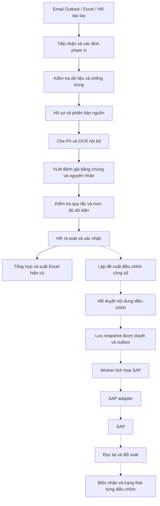
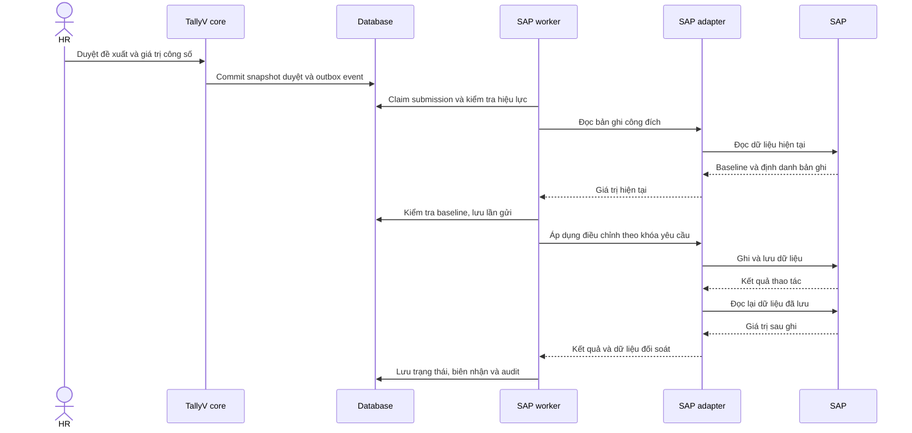

# Kiến trúc core tổng hợp, đánh giá, phân loại công và cập nhật SAP

Tài liệu mô tả luồng nghiệp vụ từ dữ liệu điều chỉnh chấm công của khoa/phòng đến kết quả được ghi nhận trên SAP. Kiến trúc gồm core xử lý hồ sơ, bước HR duyệt kết quả và bộ tích hợp SAP chịu trách nhiệm gửi, kiểm tra, đối soát từng điều chỉnh.

## 1. Phạm vi triển khai

| Thành phần | Mức độ triển khai trong repo |
| --- | --- |
| Tiếp nhận email, nhập Excel, tạo hồ sơ thủ công | Đã có |
| Kiểm tra nhân viên, phòng ban, kỳ lương và chống nhập trùng | Đã có |
| Quản lý phiên bản hồ sơ và bản sửa cần HR quyết định | Đã có |
| Che PII, OCR nội bộ, VLM đánh giá bằng chứng và phân loại nguyên nhân | Đã có |
| HR rà soát, xác nhận từng hồ sơ hoặc theo lô, lưu audit | Đã có |
| Tổng hợp số lượng hồ sơ theo bộ lọc và xuất Excel | Đã có |
| Quy đổi kết luận thành giờ/ngày công hoặc mã điều chỉnh SAP | Thiết kế mở rộng trong tài liệu này |
| Tự động ghi SAP, chống gửi lặp và đọc lại để đối soát | Thiết kế mở rộng trong tài liệu này |

Mục tiêu tự động hóa được thiết kế theo mốc HR xác nhận. Sau mốc này, hệ thống tự tạo yêu cầu cập nhật, gửi SAP và đối soát. Quy trình hiện có đặt quyền xác nhận nghiệp vụ ở HR. Phần mở rộng tiếp tục sử dụng quyền xác nhận này.

Trong luồng hiện tại, HR xuất kết quả đã rà soát để nhập SAP. Bảng `hr_submissions` và các model mô phỏng còn lưu cấu trúc, dữ liệu lịch sử. API `/api/hr` hiện cung cấp bảng tham chiếu và tạo dữ liệu mẫu. Worker đang xử lý `SYNC`, `IMPORT_EMAIL`, `DEMO`, `ASSISTANT_GENERATE`. Migration `34e98d1aa036` đã hủy các tác vụ `HR_SUBMIT` cũ còn dang dở. Khi triển khai SAP cần bổ sung đường xử lý gửi mới xuyên suốt API, database, worker và adapter.

## 2. Luồng tổng thể

Các cạnh nét đứt biểu diễn phần mở rộng SAP. Khi giao diện duyệt đã hiển thị đầy đủ công số và dữ liệu đích, bước HR xác nhận kết luận và duyệt điều chỉnh có thể thực hiện trong cùng thao tác. Trong giai đoạn chuyển tiếp, cần bổ sung bước duyệt công số vì dữ liệu xác nhận hiện tại chỉ chứa phân loại, trạng thái và ghi chú.

## 3. Ranh giới các thành phần

| Thành phần | Trách nhiệm | Đầu ra |
| --- | --- | --- |
| Tiếp nhận | Đồng bộ hộp thư, lưu tệp, xác định người gửi và phạm vi nghiệp vụ | Email, attachment và lệnh nhập |
| Chuẩn hóa | Đọc workbook, kiểm tra danh mục, chuẩn hóa ngày, quản lý trùng lặp và phiên bản | Hồ sơ có nguồn truy vết |
| Xử lý bằng chứng | Chọn profile, che PII, gọi OCR và kiểm tra artifact | Ảnh đã xử lý cùng checksum và revision |
| Đánh giá | Gọi VLM với ảnh hợp lệ, kiểm tra schema và quy tắc | Nguyên nhân, nhận xét, dữ kiện thiếu và mâu thuẫn |
| HR rà soát | Quyết định bản sửa, xác nhận phân loại và xử lý ngoại lệ | Kết luận gắn với người duyệt và phiên bản |
| Tính điều chỉnh công, dự kiến | Đối chiếu ca, dữ liệu công hiện có và chính sách quy đổi | Đề xuất điều chỉnh có giá trị trước/sau |
| Tổng hợp | Đếm hồ sơ hiện hành, tổng hợp điều chỉnh đã duyệt theo kỳ/khoa/nhân viên | Báo cáo và tập điều chỉnh cần gửi |
| Tích hợp SAP, dự kiến | Ánh xạ dữ liệu, gửi, xử lý lỗi và đọc lại | Biên nhận có thể đối chiếu với hồ sơ nguồn |

Core lưu danh tính nhân viên và dữ liệu nghiệp vụ trong database, đồng thời giới hạn payload gửi model qua `assessment_input.py`. SAP adapter nhận payload điều chỉnh đã được duyệt và cấu hình ánh xạ đích. Thay đổi cơ chế giao tiếp SAP được xử lý trong adapter.

## 4. Tiếp nhận, chuẩn hóa và phiên bản

### 4.1. Xác định phạm vi

Email được đối chiếu với danh sách người gửi của phòng ban và hộp thư nhận. Tiêu đề có thể khai báo kỳ và đợt bằng `[DCC] [YYYY-MM] [WEEK:YYYY-MM-DD]`. Chế độ Outlook thử nghiệm còn áp dụng nhãn `[TALLYV-MVP]`. Một số trường hợp Outlook có thể suy ra kỳ và phòng ban từ workbook khi dữ liệu cho kết quả duy nhất. Email thiếu phạm vi hợp lệ chuyển sang `NEEDS_REVIEW`.

Kỳ lương chạy từ ngày 26 tháng trước đến ngày 25 tháng được đặt tên. Đợt rà soát được xác định bằng ngày thứ Bảy thuộc kỳ, ngày tổng hợp là thứ Hai sau đó. Ngày nhận thư được lưu phục vụ truy vết. Hồ sơ email thiếu mốc tuần giữ trạng thái chưa gán đợt. Các quy tắc lịch dùng múi giờ `Asia/Ho_Chi_Minh`.

### 4.2. Kiểm tra đầu vào

Workbook dùng sheet `DieuChinh`, có mã hồ sơ, mã nhân viên, họ tên, phòng ban, ngày xảy ra, ca làm, lượt thiếu, giải trình và bằng chứng. Import kiểm tra nhân viên tồn tại, tên và phòng ban khớp danh mục, ngày xảy ra thuộc kỳ đã xác định. Lỗi được lưu theo dòng để HR yêu cầu bổ sung, các dòng hợp lệ vẫn được tiếp nhận.

### 4.3. Chống trùng và xử lý bản sửa

- Email được đối chiếu qua định danh nguồn và `message_id`.
- Tệp đính kèm được kiểm tra trùng trong phạm vi nhập tương ứng.
- Mỗi phiên bản hồ sơ có fingerprint từ dữ liệu chuẩn hóa và hash các ảnh. Database đặt unique constraint trên `case_id` và `fingerprint`.
- Hồ sơ mới tạo phiên bản `ACTIVE`. Nội dung mới cho mã hồ sơ đã có tạo phiên bản `PROPOSED`, đồng thời đưa trạng thái HR về `PENDING_REVIEW`.
- HR chọn áp dụng hoặc từ chối bản sửa. Khi áp dụng, phiên bản cũ thành `SUPERSEDED` và bản sửa thành `ACTIVE`. Quyết định phiên bản yêu cầu HR rà soát lại.

Fingerprint hiện có bảo vệ việc nhập lại cùng dữ liệu trong một hồ sơ. Phần tính công cần thêm kiểm tra nhiều mã hồ sơ cùng yêu cầu điều chỉnh một nhân viên, ngày, ca và trường đích để giải quyết xung đột trước khi gửi SAP.

## 5. Đánh giá bằng chứng và phân loại

### 5.1. Chuẩn bị bằng chứng

Backend kiểm tra ảnh với profile bố cục, giữ vùng nghiệp vụ và che vùng PII, sau đó gửi ảnh trung gian đã che đến OCR nội bộ. Kết quả OCR được dùng để che tiếp các vùng chữ ngoài vùng cho phép. Backend lưu PNG cuối cùng, checksum, profile và revision cấu hình.

Lượt đánh giá chỉ chạy sau khi toàn bộ bước tiền xử lý trong batch hoàn tất. Lỗi tiền xử lý chặn batch gọi VLM. Ảnh được chuyển HR rà soát có thể đi cùng ảnh hợp lệ trong hồ sơ, khi đó kết quả vẫn ghi nhận bằng chứng cần HR xử lý. Hồ sơ thiếu ảnh hợp lệ hoặc có trên 10 ảnh sẵn sàng chuyển `MANUAL_REVIEW` theo logic hiện tại.

### 5.2. Hai kết quả nghiệp vụ

| Trục đánh giá | Giá trị | Ý nghĩa |
| --- | --- | --- |
| Nguyên nhân `category` | `FORGOT_CHECK` | Quên chấm vào hoặc ra |
| Nguyên nhân `category` | `DEVICE_ERROR` | Lỗi máy hoặc hệ thống |
| Nguyên nhân `category` | `LEAVE_NOT_RECORDED` | Phép chưa được ghi nhận |
| Nguyên nhân `category` | `UNKNOWN` | Chưa xác định được nguyên nhân |
| Nguyên nhân `category` | `CUSTOM_*` | Nhóm do HR tạo trong danh mục |
| Mức đủ dữ kiện `assessment` | `SUFFICIENT` | Đủ dữ kiện theo các kiểm tra hiện hành |
| Mức đủ dữ kiện `assessment` | `MISSING` | Thiếu dữ kiện hoặc bằng chứng chưa đủ |
| Mức đủ dữ kiện `assessment` | `CONFLICT` | Có bằng chứng mâu thuẫn |

VLM trả category, lý do và nhận xét cho từng ảnh với quan hệ `SUPPORTS`, `CONTRADICTS` hoặc `INSUFFICIENT`. Backend kiểm tra category thuộc danh mục, từng ảnh được đánh giá đúng một lần, sau đó bổ sung các kiểm tra về giải trình, ca và lượt chấm còn thiếu theo quy tắc. `CONFLICT` được ưu tiên khi có mâu thuẫn, tiếp theo là `MISSING`, còn lại là `SUFFICIENT`.

Kết quả lưu model, phiên bản quy tắc, revision xử lý PII và định danh các ảnh liên quan. Nếu quy tắc thay đổi trong lúc suy luận, lượt đánh giá bị đánh dấu lỗi để chạy lại. Khi HR sửa quy tắc, các hồ sơ bị tác động được đưa về chưa đánh giá và cần xác nhận lại.

### 5.3. Quyền xác nhận của HR

Duyệt lô áp dụng cho hồ sơ đang `PENDING_REVIEW`, kết quả VLM `COMPLETED`, assessment `SUFFICIENT`, category đã xác định, toàn bộ bằng chứng hợp lệ theo revision hiện tại và các bản sửa đã được quyết định. HR xác nhận riêng có thể xử lý ngoại lệ với lý do và xác nhận ngoại lệ theo API hiện có.

`CONFIRMED` lưu kết luận rà soát của HR cùng người và thời điểm duyệt. Phần mở rộng SAP cần một bản duyệt bao gồm công số cụ thể và payload đích trước khi phát lệnh ghi.

## 6. Tính điều chỉnh công số

Đây là thành phần dự kiến bổ sung. Dữ liệu hiện tại chủ yếu mô tả giải trình, ca làm và lượt chấm thiếu. Để tạo điều chỉnh gửi SAP cần bổ sung dữ liệu lịch ca chính thức, bản ghi công hiện tại, phép được duyệt và chính sách quy đổi áp dụng cho từng nhóm nhân viên.

### 6.1. Đầu vào và kết quả

| Đầu vào | Cách sử dụng |
| --- | --- |
| Phiên bản hồ sơ hiện hành và category HR đã duyệt | Chọn yêu cầu và căn cứ nghiệp vụ |
| Mã nhân viên và mã định danh SAP tương ứng | Định vị đúng nhân viên trong hệ thống đích |
| Ngày làm việc, ca, múi giờ, lịch phân ca | Xác định khoảng thời gian, xử lý ca qua ngày |
| Giờ vào/ra và số công đang có trên SAP | Tạo baseline trước điều chỉnh |
| Giờ được xác minh, đơn phép hoặc quyết định liên quan | Xác định giá trị cần bổ sung |
| Quy tắc công, nghỉ, làm tròn và quy đổi có phiên bản | Tính số lượng và mã nghiệp vụ đích |
| Thông tin kỳ công và quyền cập nhật trên SAP | Kiểm tra khả năng áp dụng |

Đầu ra là đề xuất điều chỉnh gắn với từng bản ghi đích, có thao tác dự kiến, giá trị trước/sau, đơn vị giờ hoặc ngày, mã nghiệp vụ, công thức hoặc quy tắc áp dụng và danh sách hồ sơ làm căn cứ. Số lượng công nên dùng biểu diễn thập phân chính xác theo độ chính xác thống nhất với hệ thống đích.

### 6.2. Xử lý theo nguyên nhân

| Nhóm | Dữ kiện bổ sung cần có để tính công |
| --- | --- |
| Quên chấm | Lượt vào/ra cần bổ sung, thời điểm được xác minh và ca chính thức |
| Lỗi máy | Dữ kiện sự cố, khoảng thời gian làm việc được xác minh và dữ liệu công hiện tại |
| Phép chưa ghi nhận | Phê duyệt phép, loại phép, thời lượng, ngày hiệu lực và mã ánh xạ SAP |
| Chưa rõ nguyên nhân | HR bổ sung căn cứ và xác định phương án điều chỉnh |
| Nhóm tùy chỉnh | Quy tắc tính công và ánh xạ SAP được cấu hình cho nhóm |

Ví dụ, nhân viên thiếu lượt ra và bằng chứng cho thấy lỗi máy cần được đối chiếu với ca, giờ ra được xác minh và bản ghi SAP trước khi lập đề xuất. Số công sau điều chỉnh được tính theo chính sách đã cấu hình. Category là một đầu vào của quyết định này.

## 7. Tổng hợp kết quả

Tổng hợp hồ sơ hiện tại sử dụng phiên bản hiện hành cùng bộ lọc nguồn, kỳ, đợt, khoa/phòng, nguyên nhân, mức đánh giá và trạng thái HR. Dashboard thống kê tổng hồ sơ, hồ sơ chờ duyệt, cần bổ sung, đã xác nhận, tình trạng nhập thư và tiến độ phòng ban.

Phần mở rộng bổ sung các chỉ tiêu sau.

| Chỉ tiêu | Đơn vị và nguồn tính |
| --- | --- |
| Hồ sơ theo nguyên nhân | Số hồ sơ hiện hành, sử dụng phân loại HR khi đã được xác nhận |
| Điều chỉnh công được duyệt | Số đề xuất điều chỉnh có snapshot duyệt còn hiệu lực |
| Tổng giờ/ngày công điều chỉnh | Cộng theo nhân viên, kỳ và cùng đơn vị công, tách theo mã nghiệp vụ cần thiết |
| Tiến độ SAP | Số điều chỉnh đang chờ, đang gửi, đã đối soát và cần xử lý |
| Tác động công đã ghi nhận | Tổng chênh lệch thực tế của các điều chỉnh đã đối soát thành công |

Một điều chỉnh có thể gom nhiều hồ sơ cùng căn cứ, một hồ sơ cũng có thể tạo nhiều mục cập nhật. Báo cáo lưu quan hệ này để truy về dòng Excel, phiên bản hồ sơ, kết quả đánh giá và người duyệt. Khi tính tổng, xử lý các yêu cầu trùng hoặc xung đột trên cùng bản ghi đích trước khi cộng công.

Xuất Excel hiện có trả các hồ sơ khớp bộ lọc cùng trạng thái HR và nguồn gốc. Khi dùng file làm đầu vào cho quá trình ghi SAP, cần chốt bộ lọc đã duyệt và kiểm tra snapshot của từng mục.

## 8. Thiết kế cập nhật SAP tự động

### 8.1. Chốt hợp đồng tích hợp

Cơ chế giao tiếp cần được xác định theo môi trường SAP được cấp. Adapter được triển khai theo giao diện tích hợp đã thống nhất với đội SAP. Nếu phạm vi thực tế sử dụng SAP desktop, adapter cần thao tác qua SAP GUI Scripting trên máy có phiên đăng nhập và cấu hình được cấp.

Các thông tin còn cần xác định gồm hệ thống và client đích, loại dữ liệu công, giao diện đọc/ghi hoặc transaction, các trường bắt buộc, đơn vị, mã nghiệp vụ, khóa bản ghi, quyền cập nhật và quy tắc kỳ đã khóa. Tài liệu này sử dụng payload trung gian của TallyV, tên trường và transaction SAP sẽ được ánh xạ khi có hợp đồng môi trường.

### 8.2. Payload trung gian dự kiến

| Nhóm | Trường đề xuất |
| --- | --- |
| Định danh yêu cầu | `submission_id`, `idempotency_key`, `target_system`, `target_client` |
| Nguồn được duyệt | `source_case_versions`, `approval_id`, `approval_hash`, `approved_by`, `approved_at` |
| Định vị bản ghi công | `employee_id`, `sap_personnel_id`, `work_date`, `shift_id`, `target_record_key` |
| Nội dung điều chỉnh | `operation`, `attendance_code`, `check_in`, `check_out`, `quantity`, `unit`, `timezone` |
| Kiểm soát thay đổi | `mapping_version`, `calculation_rule_version`, `expected_before`, `expected_revision` |
| Giải trình | `hr_category`, `reason`, `source_references` |

`expected_revision` được dùng khi giao diện SAP hỗ trợ phiên bản bản ghi. Với giao diện khác, adapter đọc lại baseline và thực hiện cơ chế kiểm soát đồng thời phù hợp với hệ thống đích. Khả năng ngăn ghi đè giữa lúc đọc và ghi phải được xác minh khi chọn giao diện tích hợp.

### 8.3. Giao dịch và outbox

Trong cùng giao dịch database, core lưu snapshot đề xuất đã được HR duyệt, mã băm của snapshot và một outbox event cho submission. Ràng buộc unique trên khóa yêu cầu bảo vệ thao tác duyệt hoặc enqueue bị lặp.

Worker nhận event sau commit, kiểm tra snapshot duyệt còn hiệu lực, ánh xạ còn hợp lệ và đọc dữ liệu đích. TallyV ghi nhận lần gửi trước khi gọi adapter, đồng thời giữ lease để một submission chỉ có một tiến trình thực thi tại một thời điểm. Mỗi mục trong lô có định danh và trạng thái riêng.

Snapshot duyệt cần bao gồm toàn bộ phiên bản hồ sơ nguồn, phiên bản chính sách tính công, mapping và nội dung điều chỉnh. Khi các đầu vào này thay đổi, submission chờ gửi được chuyển `STALE` và đề xuất phải được duyệt lại. Khi thay đổi xảy ra lúc đang gửi, hệ thống theo dõi kết quả thực tế của lần gửi đó và xử lý chênh lệch trên cơ sở biên nhận.

### 8.4. Gửi và đối soát

Một submission đạt `APPLIED` khi dữ liệu đọc lại phù hợp snapshot duyệt theo tiêu chí đối soát của mapping. Biên nhận lưu định danh bản ghi SAP, khóa yêu cầu, giá trị trước/sau, thời điểm, kết quả thao tác và dữ liệu kiểm chứng.

Nếu SAP đã ghi nhưng kết nối bị mất trước khi TallyV nhận phản hồi, submission chuyển `RECONCILING`. Worker tra khóa yêu cầu hoặc lịch sử đích khi giao diện hỗ trợ, đồng thời đọc lại bản ghi để xác định kết quả. Khi kết quả còn mơ hồ, hệ thống giữ trạng thái cần đối soát để xử lý tiếp. Retry chỉ thực hiện sau khi xác định được điều kiện gửi lại an toàn.

Với SAP GUI Scripting, adapter cần kiểm tra đúng hệ thống/client, transaction, mã nhân viên, ngày hiệu lực, thông báo lưu và giá trị đọc lại. Phiên đăng nhập bị gián đoạn hoặc màn hình thay đổi được lưu thành lỗi thực thi của từng submission.

### 8.5. Trạng thái submission dự kiến

| Trạng thái | Ý nghĩa và hướng xử lý |
| --- | --- |
| `QUEUED` | Snapshot đã duyệt đang chờ worker |
| `SENDING` | Đang thực thi với lease và lần gửi đã lưu |
| `RECONCILING` | Cần xác định kết quả của lần gửi hoặc kiểm tra dữ liệu sau ghi |
| `APPLIED` | Giá trị sau ghi đã đối soát đúng |
| `RETRY_PENDING` | Lỗi tạm thời đã xác định điều kiện retry, chờ backoff |
| `BLOCKED` | Cần bổ sung mapping, mở kỳ, cấp quyền hoặc quyết định nghiệp vụ |
| `STALE` | Snapshot duyệt hết hiệu lực do đầu vào đã thay đổi |
| `FAILED` | Hết số lần thử hoặc gặp lỗi cần xử lý thủ công |
| `CANCELLED` | Yêu cầu chờ gửi được hủy có lưu lý do |

Lỗi mạng trước khi thực hiện ghi có thể retry với cùng khóa yêu cầu và backoff có giới hạn. Lỗi sai mã nhân viên, mã công, khóa kỳ hoặc xung đột baseline chuyển `BLOCKED`. Khi worker mất lease giữa lần gửi, tiến trình phục hồi chuyển sang đối soát trước khi quyết định gửi tiếp. Lô hoàn tất một phần giữ kết quả riêng từng mục để tiếp tục xử lý phần còn lại.

Điều chỉnh đã `APPLIED` giữ nguyên lịch sử và biên nhận. Nếu HR thay đổi kết luận sau đó, core lập đề xuất điều chỉnh tiếp theo hoặc đảo điều chỉnh theo khả năng của hệ thống đích, liên kết với submission gốc và yêu cầu duyệt lại.

## 9. Truy vết dữ liệu và kiểm soát đồng thời

| Đối tượng | Trách nhiệm hiện có hoặc dự kiến |
| --- | --- |
| `Email`, `Attachment`, `ImportBatch` | Lưu nguồn, checksum và kết quả nhập từng dòng |
| `AttendanceCase`, `CaseVersion` | Lưu danh tính hồ sơ, phiên bản hiện hành và bản sửa |
| `EvidenceFile`, `EvidencePrivacy` | Lưu bằng chứng, artifact đã che, checksum và revision xử lý |
| `AnalysisResult` | Lưu category, mức đánh giá, model, quy tắc và dữ kiện liên quan |
| `AuditLog` | Lưu người thao tác, trạng thái trước/sau và lý do |
| Snapshot điều chỉnh và bản duyệt, dự kiến | Lưu công thức, công số, baseline, nguồn và hash được duyệt |
| Submission, outbox và lần gửi, dự kiến | Lưu trạng thái bền, lease, retry và khóa chống gửi lặp |
| Biên nhận SAP, dự kiến | Lưu liên kết đích và dữ liệu đối soát trước/sau |

Các thao tác review và quyết định phiên bản hiện tại khóa hồ sơ trong database. Lượt VLM kiểm tra `privacy_request_id`, manifest ảnh và revision để loại kết quả cũ hoặc phát lại. Phần SAP bổ sung khóa theo bản ghi đích để xử lý các submission cùng nhân viên/ngày/trường công theo thứ tự đã xác định.

Database và kho file cần được sao lưu cùng nhau để bảo toàn quan hệ nguồn, ảnh, kết quả và quyết định HR. Khi bổ sung SAP, dữ liệu sao lưu cần bao gồm outbox, lần gửi và biên nhận để có thể đối soát sau khôi phục.

## 10. Thực thi nền và phục hồi

Luồng email hiện dùng queue PostgreSQL, có claim, lease và retry có giới hạn. Worker MVP dùng advisory lock để giữ một scheduler hoạt động. Kết quả nhập hồ sơ và hoàn tất job được commit trong cùng giao dịch.

Che PII, OCR và VLM hiện chạy nền trong process thông qua `BackgroundTasks`, `asyncio.to_thread` và thread pool sau import. Mỗi thread sử dụng database session riêng. Khi process bị dừng, HR có thể yêu cầu chạy lại bằng `POST /api/cases/{id}/reanalyze?restart_background=true`.

Luồng gửi SAP dự kiến sử dụng queue và trạng thái bền. Outbox, submission và biên nhận là cơ sở để worker khôi phục tiến độ sau restart. Có thể mở rộng hạ tầng worker hiện tại khi bổ sung xử lý SAP và kiểm thử lease, retry, kiểm soát đồng thời tương ứng.

## 11. Vị trí mã nguồn và điểm mở rộng

| Luồng | Vị trí |
| --- | --- |
| Đồng bộ và nhập | `app/services/mailbox.py`, `imports.py`, `excel.py`, `app/worker.py` |
| Kỳ lương và đợt | `app/services/review_calendar.py` |
| Hồ sơ và duyệt | `app/services/cases.py`, `app/api/cases.py`, `app/models/attendance_cases.py`, `case_versions.py` |
| Tiền xử lý ảnh | `app/services/evidence_privacy.py`, `evidence_masking.py`, `evidence_ocr.py` |
| Điều phối đánh giá | `app/services/jobs.py`, `image_background.py`, `analysis.py` |
| Đầu vào và gọi VLM | `app/services/assessment_input.py`, `evidence_vlm.py`, `evidence_vision.py` |
| Quy tắc | `app/services/rules.py`, `app/models/demo_rules.py` |
| Tổng hợp và xuất | `app/services/catalog.py`, `exports.py`, `app/crud/cases.py` |
| Tham chiếu công mô phỏng | `app/services/hr.py`, `app/api/hr.py`, `app/models/mock_hr.py` |
| Lịch sử submission | `app/models/hr_submissions.py`, `app/crud/hr.py`, migration `34e98d1aa036` |
| Mở rộng cần triển khai | Tính công, mapping SAP, snapshot duyệt, outbox, worker gửi và adapter đọc/ghi/đối soát |

## 12. Tiêu chí kiểm chứng khi triển khai SAP

- Một hồ sơ có thể truy ngược đến email, tệp, sheet, dòng, ảnh, phiên bản đánh giá, người duyệt và submission liên quan.
- Đề xuất công có quy tắc tính xác định, đơn vị rõ ràng, xử lý ca qua ngày và dữ liệu nguồn đầy đủ.
- Gửi lặp thao tác duyệt, retry job hoặc khởi động lại worker bảo toàn một kết quả nghiệp vụ trên mỗi yêu cầu đã duyệt.
- Bản sửa hồ sơ hoặc thay đổi chính sách khiến submission đang chờ chuyển `STALE` và phải được duyệt lại.
- Hai hồ sơ tác động cùng bản ghi đích được phát hiện và giải quyết trước khi ghi, đồng thời có kiểm tra xung đột với thay đổi từ phía SAP.
- Mất kết nối sau khi SAP lưu dữ liệu đưa yêu cầu vào đối soát và cho phép xác định chính xác tác động đã xảy ra.
- Lô thành công một phần có thể tiếp tục từng mục, báo cáo thể hiện riêng số hồ sơ đã duyệt và số điều chỉnh đã ghi nhận trên SAP.
- `APPLIED` luôn có biên nhận và dữ liệu đọc lại khớp snapshot được duyệt.

Các kịch bản trên cần được kiểm chứng trên môi trường SAP thử nghiệm với mapping, quyền và dữ liệu được cấp. Giao diện tích hợp, trường công số và chính sách quy đổi là các đầu vào cần chốt để hiện thực hóa phần mở rộng.

## Tài liệu liên quan

- [Quy trình chấm công và mẫu workbook](attendance.md)
- [Che PII, OCR và VLM](vlm-evidence.md)
- [Thiết lập hộp thư Outlook](outlook.md)
- [Kiến trúc và vận hành hiện tại](architecture.md)
- [Lưu trữ và sao lưu](object-storage.md)
